# Create and Install Certs for SQL Server

## Create Certs via Script

NOTE: This is a custom script to help us make this process easier. The tools it uses in the script are windows standard certificate utilities though, certutil and certreq.

1. Determine what domain we need to create the certificates for and RDP to the server for that domain that has the Create-Certificate.ps1 we need to run.
   - domDEV: xx.xx.xx.xx @ D:\Workspace\DBA\Powershell\dbcert
   - domTEST: xx.xx.xx.xx @ M:\Management\Workspace\DBA\Powershell\dbcert
   - dom:  xx.xx.xx.xx @ D:\Management\Scripts\Powershell\dbcert

1. In the folder should exist .txt files. These are the input files for the Create-Certificate script. Depending on domain, you need to use the correct input file. For example, DECSS PROD needs to be ran against dom domain, DECSS TEST against domTEST. Use the appropriate input file for the appropriate domain and servers we are creating certs for. So far only DECSS is using certs so it is pretty straight forward for now.  
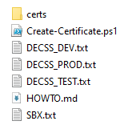

1. Verify the file we need to use has the correct info. Generally the info in the file does not need to change unless new servers were built and the hostname changed. If you are just creating a new cert because of expirary, nothing should need to change.

1. Open an admin powershell prompt and change to the directory above. Run the script, powershell requires it to be run like ```.\Create-Certificate.ps1```, note the ```'.\'```. If you start typing ```Create-``` and then hit ```TAB```, it should auto-complete and make it how powershell wants it.

1. Run the script. It will ask for the input file. Only the file name will suffice, ie ```SBX.txt```. It will also ask for a password. This password is only used during the cert deploy/install process to make the certificate portable and secure. We dont want unsecure certs sitting around.

1. Once the script completes, you will see a small table of the work it has done including the hostname, expirary, friendly name, etc. This info can be copied and pasted into the Certificates Excel for alerting purposes.  
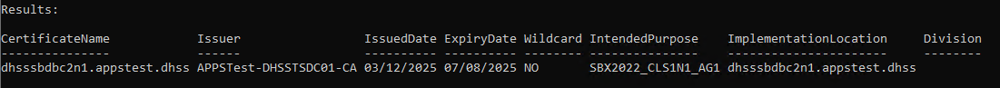

   [Certificates](https://wss.domain.com/dms/irm/Enterprise%20Operations/Forms/AllItems.aspx?RootFolder=%2Fdms%2Firm%2FEnterprise%20Operations%2FCertificates%5FServer%5FList&FolderCTID=0x01200085CBAB6911B70D44AEDFF27954892A82&View=%7B89B5A270%2D2B29%2D4AC0%2D9014%2D38232E85C94A%7D)

1. The end result of the script will be pfx files in the certs subfolder, along with others(cer, inf, csr, etc), but they are intermediary files for steps to creating the pfx. The pfx files will be password protected with the password you set above. Also of note, during the pfx creation process, the certs will be created on the server's Windows Certificate Store (```certlm.msc```) running this script. This is to be expected and how the Windows certificate utilities function. They can be deleted if no longer needed on this server.  
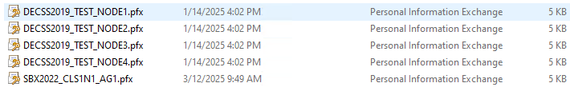
    

## Install Certs on Target Server

NOTE: This is the standard process on how to get certs on the server and how to get SQL Server to use them. This is a quick guide specific to us, but any guide online should be very similar.

Each of the below steps needs to happen on each server, if you have 4 certs you created, you'll need to do it 1x on each server, so 4x times total. You will need to copy, install, grant permission, and point SQL Server at the certificate.

1. Copy the pfx file we created above to the server, location does not matter and once imported and we are done it can be deleted.

1. Install the cert on each server respectively. This is accomplish by double clicking, it will open a dialog to start the process.
      1. Install to local machine, click next.  
      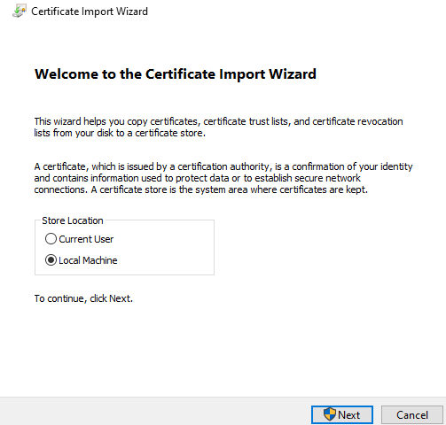

      1. Next screen shows the file we chose, click next.
      1. Enter the password we created above when you ran the script, leave other options at default and click next.  
      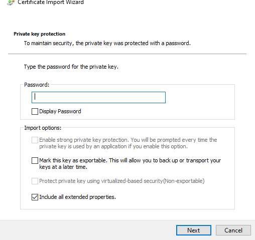

      1. Automatic, click next, then click finish. 
      1. You'll get a confirmation, click ok.
1. The cert is installed on the local machine store now. Next we need to grant the SQL service account the permission to read the cert in the store.
      1. Open ```certlm.msc``` from start menu and browse to **Personal**, you should see a list of certs, including the one we just imported. If this is for a renewal, you may see the old and new with similar/same names.           
      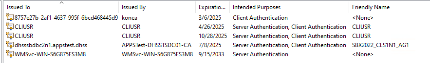

      1. Find and double-click on the new cert to view its properties and verify the validity dates, if they are named the same, check for the newer dated cert. If looking at the correct one, the validity date should start with when you created the cert and end date should hopefully be a year or 2 away. After finding the new certificate, also check the Thumbprint value on the Details tab of the certificate. Write down or remember the last 4-6 chars on the value, we'll want to verify SQL Server is using this cert later. Note, if you are doing this for multiple servers, they have their own cert and will have different thumbprints.  
      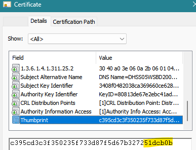

      1. Once you find the right one, cancel out of the properties window, right-click on the same cert, **All-Tasks->Manage Private Keys...**           
      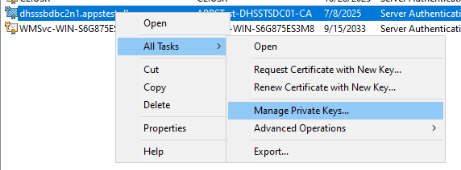

      1. In the permissions screen, click **Add**. 
      1. On next window click **Location** and chose the first option, just the local server, not the domain directory, click OK.
      1. In bottom text box, enter the object name as ```NT SERVICE\MSSQL$<instance>``` subsitituting the instance name, example: ```NT SERVICE\MSSQL$SB2022_1```. Click Check Names and it should update the name. This will be different on every server as the instance names are all different. Click OK.           
      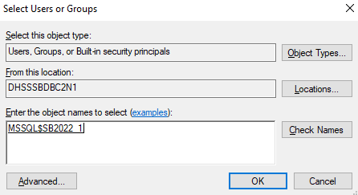

      1. Back on the previous screen make sure you hightlight what we just added and grant **READ** permissions only. When done, click OK to close permissions window. We are done setting permissions now. You can close Cert Manager.

## Set SQL Server to use the new Certificate

1. Once certificate is installed on server we need to tell SQL to use it.

1. Open **SQL Server Configuration Manager**. Note, if this server was an in-place upgrade, SQL Config Man gets lost on the State Menu. You can do Run and then the correct path for the version of SQL below.  

   | Version                | Path                                       |
   | ---------------------- | ------------------------------------------ |
   | SQL Server 2022 (16.x) | C:\Windows\SysWOW64\SQLServerManager16.msc |
   | SQL Server 2019 (15.x) | C:\Windows\SysWOW64\SQLServerManager15.msc |
   | SQL Server 2017 (14.x) | C:\Windows\SysWOW64\SQLServerManager14.msc |
   | SQL Server 2016 (13.x) | C:\Windows\SysWOW64\SQLServerManager13.msc |

1. Browse to and expand **SQL Server Network Configuration**, right-click on **Protocols for \<instance name\>** and choose **Properties**.  
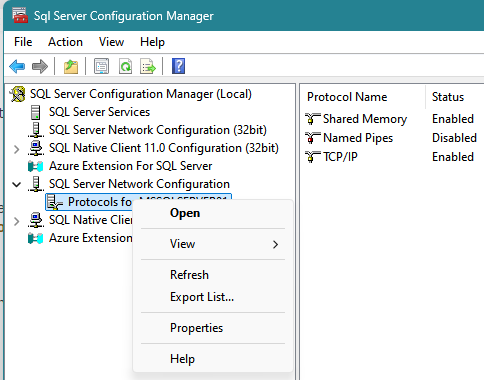

1. Go to the **Certificate** tab, find the certificate you need, you can click view to verify its new one, via date or thumbprint and then click **OK**.  
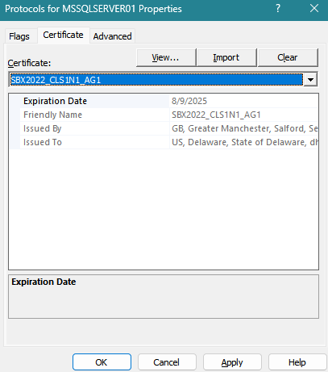

1. Restart SQL Server service.  
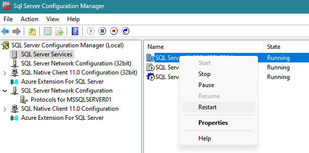

1. Once restarted you can view the SQL log in SSMS and verify it is using the certificate. You will see something like below in the first 50 or so lines of a log. Make sure the cert thumbprint matches what you noted above. Each server will have its own thumbprint, so it will need to be verfied on each one seperately. You dont need to match the whole cert thumbprint, matching the last couple chars will be enough.  
  

END