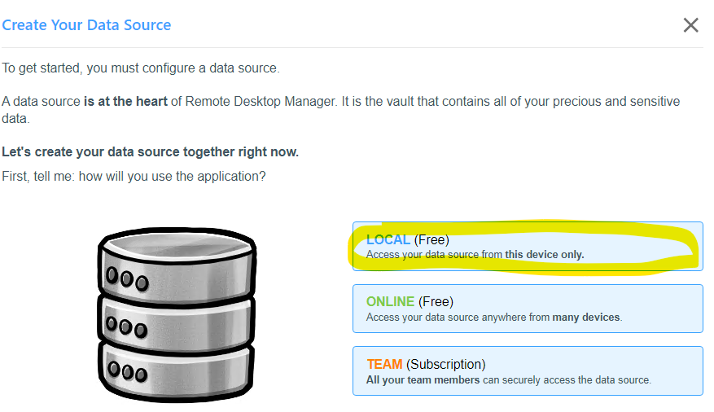
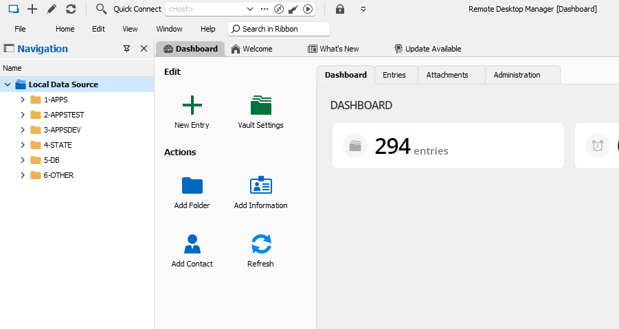
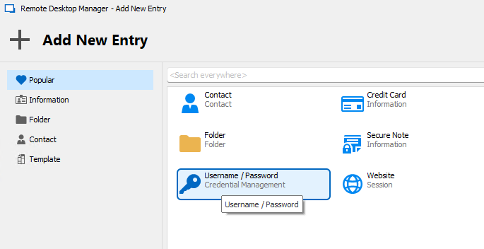
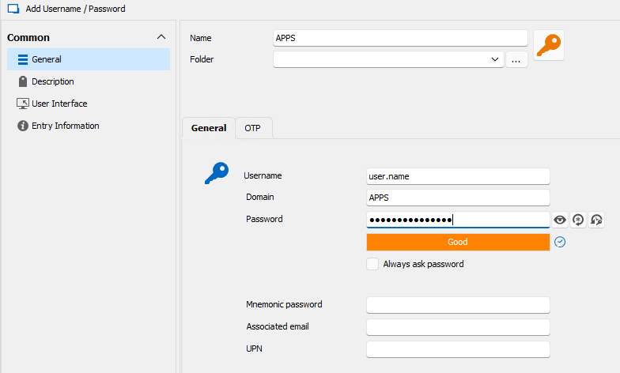
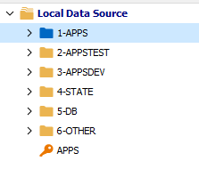
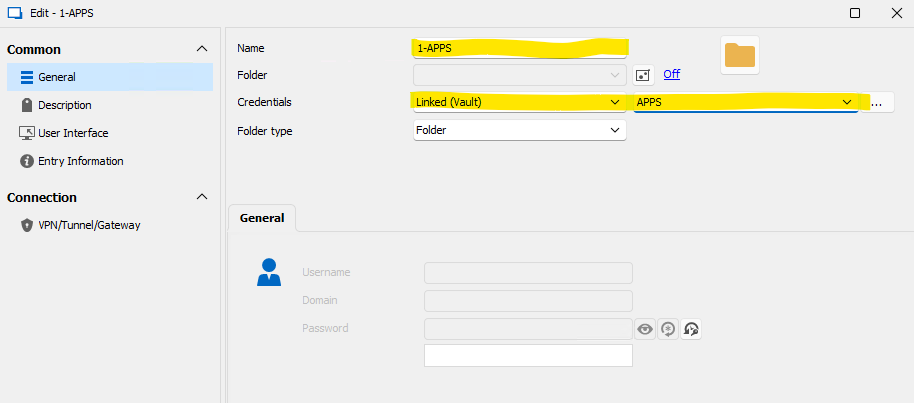
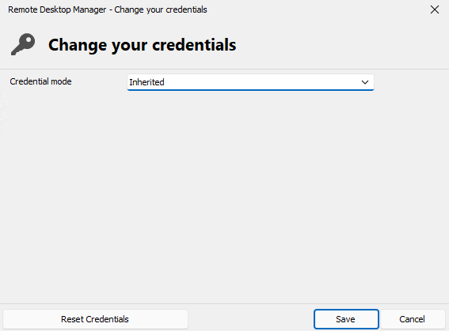
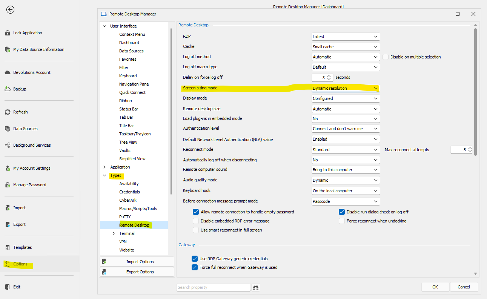

# Devolutions RDM

## Setup Devolutions RDM (DevoRDM)

1. Download and install Devolutions RDM from their [website](https://devolutions.net/remote-desktop-manager/home/downloadfree/).
   
2. Get our Devo RDM sessions file: [basetech_sessions_dba.rdm](https://devops.domain.com/dept/0864cb35-f32a-4db8-8975-e47e1926d931/_apis/git/repositories/94769bf6-0494-4820-a085-56b6c8123bc3/items?path=/Reference/files/basetech_sessions_dba.rdm&versionDescriptor%5BversionOptions%5D=0&versionDescriptor%5BversionType%5D=0&versionDescriptor%5Bversion%5D=main&resolveLfs=true&%24format=octetStream&api-version=5.0&download=true)
   
3. Install DevoRDM, you can do the 'Typical' install and next thru the installer.
   
4. On first launch, it will ask you to create a 'Vault', use 'LOCAL(free)' and confirm. The 'Vault' stores all your sessions and credentials.
   

4. You can skip or import the Basetech sessions now or later. It does not matter. If you choose to import, pick .rdm and pick the file you downloaded earlier, ```basetech_sessions_dba.rdm```

5. User Interface Profile: DevoRDM has a lot of options and extra tools, Business User seems to work for RDP and doesn't show some of the extras that we may not need.You can choose Business Uer now and change to IT Pro later if you would like to explore.

6. Once the setup wizard is completed, you'll see a screen like below. The root folder are broken down by domain, then subnet/zone under that. 

   

7. Before any of the sessions are usable, we need to add some credentials for the sessions. Right click on the root **Local Data Source** and **New Entry**. Find or search for **Username / Password**.
   
   

8. Create a credential entry for each of the domains: dom, domTEST, domDEV, STATE
   
   

9. They will show up like this in the root path.
    
   

10. Once all credtials are created, right-click **Properties** on each of the folders and assign that credential to the matching named folder.

    

11. Now, we need to make sure inheritance is enabled for all the sessions so that the credential set at the folder root is inherited down to all the sessions in the subfolders. You can do the root folders one at a time or all at once. Select the folder(s) and right-click **Edit**->**Batch Edit**->**Change Saved Credentials**. Then change to inheritated and click save. Now all the sessions under that path should inherit the crednetials set on the root folders.

    

12. Next we should change the dynamic scaling for desktop connections, otherwise it will stay small and not auto-resize. Go to **File**->**Options**->**Type**->**Remote Desktop** and change **Screen sizing** mode to **Dynamic resolution**, click **OK**.

    

12. You should now be able to connect to any session in any folder with dynamic resolution chanages.

DONE