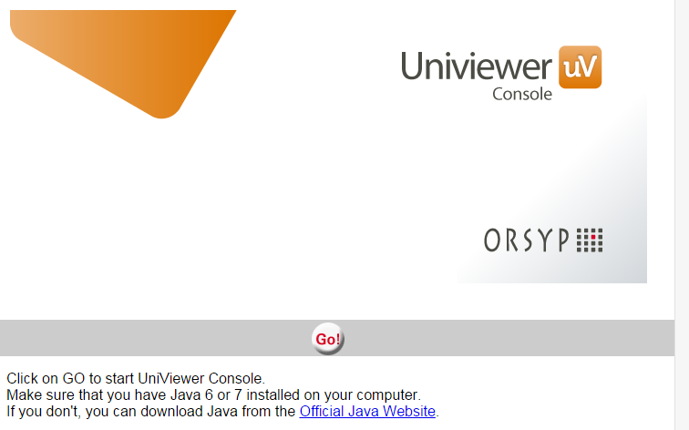
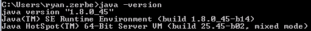
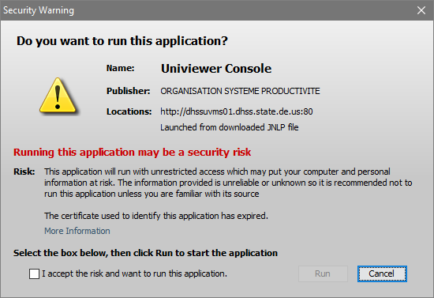
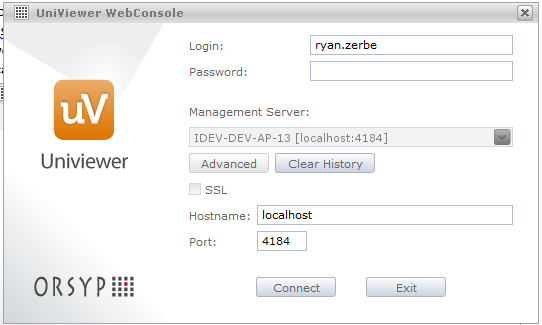
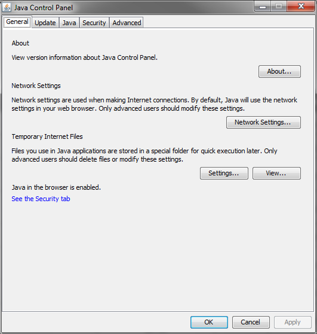
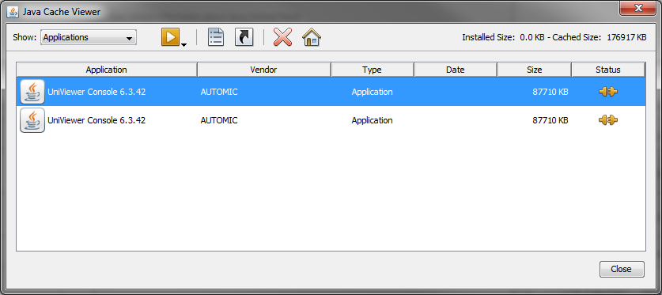
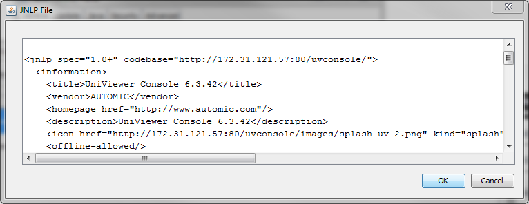

# Accessing Dollar Universe

## Pre-requisites

domdev domain account for DEV

STATE domain account for TEST/PROD

Note for domDEV: 

Because of a limitation of $U, it cannot change your domDEV domain account. If you are having a new account created to access $U and you have no access to any other servers in domDEV domain, you need to request from the Helpdesk that your password not expire and also not required to be changed at first logon. If you have access to another domDEV server via RDP or other means and can change your password, then you should be able to change your password in that manner.

### Java 

32bit or 64bit, use the same as your operating system, most likely 64bit. Version 6, 7, or 8 all should work. You can find the latest fully free version of java here. **I:\\BaseTech\\Java**

### Web Browser

IE, Edge, and Chrome all work.

## Accessing the Console

DEV/SIT (domdev domain) URL: [http://xx.xx.xx.xx/uvc/]

TEST/PROD (state domain) URL: [http://deptuvms01.domain.com/uvc/]

1. Click on the above link to access the console page.

   

1. Click the 'Go' button.

1. Wait for the uvc.jnlp file to download and then launch/click it.

   If nothing is associated with the .jnlp file and you are sure you have java installed, browse to your java\\bin directory and open it with javaws.exe when it prompts you what to open the file with.

   You can check your java/version by going to the command prompt and typing 'java -version', if you get a response it will show the version otherwise you probably don't have Java installed.

   

1. Wait for the application to download and then launch, you will need to agree to launch the application by accepting the security warning, check the box and click 'Run'.

   

1. Once you get the logon screen enter your domdev or state account info\--'firstname.lastname' and password. **DEV/SIT uses your domDEV account credentials and TEST/PROD uses your STATE account credentials.** STATE account is what you use to logon to your desktop. There is no need to enter the domain**.** Click advanced and enter 'localhost' for Hostname and 4184 for the port if is not already filled in. 'localhost' in this case is relative to the server, it is not your local desktop you are trying to connect to. If you have issues, you can enter xx.xx.xx.xx for DEV or deptuvms01.domain.com for TEST/PROD.

   

1. Click connect and you should be in.

## Notes

- **\$U does not support changing domain passwords, so if your password is expired, you will need to change it elsewhere. For PROD (state domain) this should not be an issue since you will already be logged onto your desktop. For DEV/SIT (domdev domain), you will need to change it elsewhere, either via RDP on an domdev server, an application using domDEV, or as a last resort the helpdesk. Ask to reset it and make it non-expiring and not needed to be changed upon first logon. The helpdesk is aware of this limitation with \$U in domDEV and should accommodate you.**

- Be careful with incorrect passwords, these are linked to your domain accounts, 3x incorrect for domdev and 7x incorrect for state and it will suspend your account for 30 minutes.

- The \$U Admins cannot unlock your accounts if you are using domain accounts to access \$U, you will need to contact the helpdesk or wait 30 minutes for them to unlock.
  
If you have any issues or any comments on this document, please contact Ryan Zerbe or Kevin Hudson.

- Documentation about using the Console or any other aspect of \$U can be found on Sharepoint.

[Dollar Universe Manuals](https://wss.domain.com/dms/irm/basetech/Shared%20Documents/Dollar%20Universe/Documentation)

## $U Reports (all applications)

### Prod

There is only 1 active list being used by $U internally, this is what sends the daily Excel reports.

Send an email to:

    listserv@listserv.delaware.gov

With a command in the body like below, use your name though:

    SUBSCRIBE db_DOLLAR_UNIVERSE_PROD Ryan Zerbe

## Creating Shortcuts (optional)

### Information

When visiting the Webconsole website and clicking the \'GO\' button, you are downloading a .jnlp file, which is a Java Web Start file. It points to the location that the Webconsole is running from. In our case this is running on top of Apache Tomcat, a java applet server. Opening the jnlp file downloads the application to your desktop and stores it into the Java cache on your PC. Relaunching the JNLP checks for updates being hosted on Tomcat and downloads the updates if needed.

You will need to launch the JNLP file at least once for the application to download and appear in the Java cache.

To make using the console easier, there is a way you can create shortcuts that point directly to the application being held in the java application cache. Follow the steps below to create icons on your desktop and from there you can move them where ever you want.

1. Type \'java\' on your start menu and open \'Configure Java\'. This window will appear. Click on 'View...'

   

1. This will open the Java Cache Viewer. If you have accessed both DEV and TEST\\PROD environments you may see 2 entries for UniViewer Console 6.3.42.

   

1. To determine which is which, right click on one and choose 'Show JNLP File'. On the 7^th^ line of the window that opens, look for "href=". The value following that should either be xx.xx.xx.xx:80 or deptuvms01.domain.com:80. The former is DEV and the latter is TEST\\PROD. Make note and click ok.

   

1. Go back to the same entry and choose the same application and click 'Install Shortcuts'. This will Create a short-cut on your desktop for that application. Go to that icon on the desktop (default location) and rename it to 'UVMS-DEV' or 'UVMS-PROD' or something similar depending on which you create the shortcut for. Then go back and do the same thing for the other application for the other environment. The icons can be moved to your preferred location at this point.

1. You should now have 2 easily accessible icons on your desktop (or if you moved them) to get to either UVMS. Newer version of Java also seem to place them on your Start Menu. You can now cancel out of all the Java dialog boxes.

### Appendix

You can also find it on the DMSIRM Developer drive (I:)

    I:\BaseTech\$U\

#### Problems\\Troubleshooting

If you have any issues accessing \$U, if anything in this document is unclear, or anything else, please contact your \$U Admin.

- Ryan Zerbe
- ryan.zerbe@delaware.gov
- 302-255-9096