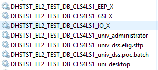
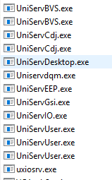
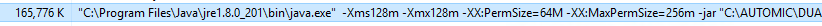
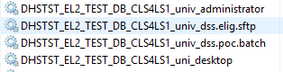
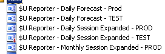
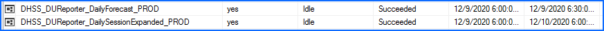

# $U FAQs and Troubleshooting

## General Info

### UVMS Console

The UVMS consoles can be reached at:

[**Prod\\Test**](http://deptuvms01.domain.com/uvc/) (Use State Login)

[**Dev\\Sit**](http://xx.xx.xx.xx/uvc/) (use domDEV login)

### Services

$U runs 5 windows services under the default installation, but can have more if there are extra submission accounts added for job submission, dss.elig.sftp and dss.poc.batch are the extra additions in the screenshot below. The other 5 are the default.

### Universe.log

$U universe log file can be found at the default install location, which is usually a data or app drive, D or E.

    E:\Automic\DUAS\<nodename>\log\universe.log

In the case of a SQL cluster, it's installed on the M drive and if $U is cluster (DECSS Only), its installed on W.

    M:\Automic\DUAS\<nodename>\log\universe.log

All error messages for each node will appear here. On some systems it can be quite large and take some time to open. Use notepad++ to open if available, use right-click menu. The log is timestamped, oldest at top, newest at bottom. It has more info then just errors, so there is a lot of informational messages as well. For example, error messages about nodes not being able to contact each other is acceptable if the nodes in question are not in the same zone. EL2 and IDMZ2 for example. These nodes will never be able to contact each other and all communication for jobs would go thru the UVMS first. Unless you know for sure that some node should be able to connect with another, it's safe to ignore these messages.

Sample error message:

    | 2019-08-10 19:24:36 |ERROR|X|IO |pid=20956.16604 | <source> | Error ....

## Common Problems and Fixes

### Node Not Responding in the Console

Look at the console and see if the node is up: Administration Mode-\>Nodes-\>Nodes. If there is a node marked as not connected, there may be a note about why on the information column, for example "Disk Full warning". If the node appears to be connected, but not functioning properly, right click on the node and click 'Server Engine List'. This will give a list of all the services and sub processes that are spawned on the node for $U to function.

There are some services that are acceptable to be not started. SAP is acceptable to be not running on any node. JEE is acceptance to be not running on a non-SQL cluster. JEE is what executes the SQL plugin, if there is a SQL Server and its using SQL Server integration, JEE needs to be running as well. Everything else should be green. Depending on the service, you may be able to restart the services from this screen, but I prefer to go to the server and do it there.

RDP to the desktop and open Task Manager (or services.msc) and look for running services. We should have at least the 5 listed above (under general info) and more if there are extra submission accounts added. They should all be running. If it's just submission accounts, just start them, otherwise we will restart them as below.

#### Restart Services

Open an elevated cmd.exe, **cd into the $U folder**, something like **E:\\Automic\\DUAS\\\<nodename\>\\**. There should be a unienv.bat file in here. Execute **unienv.bat** in the cmd.exe to load all the $U variables for this node. It should give a message about loading successfully. Then **cd** into **bin** and run the $U stop command, **unistop all**. If this is a cluster, see below for a slightly different process.

    cd E:\Automic\DUAS\<nodename>
    unienv.bat
    cd bin
    unistop all

After that completes successfully, we should check for any sub processes that may not have ended correctly. Look at Task Manager on the Details tab and you should not see any $U services and/or processes running. All the processes will be named uni\*.exe.

If there are still processes running after you've stopped all the parent processes, right-click and end process. Also, if this is a SQL Server, you may see a java process running. To see what its actually executing, in Task Manager, right click the column header and choose **Select Columns**. Choose **Command-Line.** Once selected, you can see that it will say thing like below.

This is a $U process, so end that as well.

There should be nothing running from the Automic folder at this point.

Now, go back to the elevated cmd.exe.

    unistart

This command will start all the main processes, but it will not start the submission accounts. Once completed, go back to services in Task Manager (or services.msc) and start any of the submission accounts that might not be running.

If we are stilling having issues after stop and start attempts, you can also try running a reorg while $U services are stopped.

From an elevated command prompt:

    cd E:\Automic\DUAS\<nodename>
    unienv.bat
    cd bin
    unistop all
    unireorg
    unistart

Verify services are up and running and have the jobs run again.

#### Restart Clustered Services

This is handled a little easier as we are just going to be using Failover Manager to take all the services offline. Open Failover Manager, go to the role that has $U services, probably the SQL Server AG role as they are using the same IP resource or it could be using its own Role if not attached to the SQL role. Start by taking the IO service offline, this should take all the rest of the $U services offline as well. At this point, we can pickup just after the **unistop all** point above. Check for sub processes running, but we need to do this on any node in the cluster where $U is setup on this role. There should be only 2 nodes as we only have 2 node $U clusters.

The most common problems with clusters not responding is that somehow a failover didn't happen cleanly and there are some sub processes on the other node still running holding that IP, so when you try to start $U on the primary node, it complains that the IP is already in use. You would see this error in the universe.log. So the easiest solution is to make sure no $U processes are running on any of the nodes and then start $U on the correct active node.

Once that is completed and cleaned up, open an elevated cmd.exe, and cd to the correct path where the unienv.bat is. This is a little different process because it's a cluster and the binaries are installed on C, while the data and logs are installed on the shared drive/network share. So after loading unienv.bat, just type **C:** and you should end up in C:\\Automic\\DUAS\\\<nodename\>\\bin, from here execute **unistart.**

    cd M:\Automic\DUAS\<nodename>
    Unienv.bat
    C:
    Unistart

Once the services are started, go back to Failover Manager and bring the IO services back online. The services are already started at this point and we are only bringing them online in Failover Manager. Failover Manager should have all the services including any extra submission accounts, but check Task Manager and make sure all related $U services are started.

### $U Reports not Received

This is typically a DTI issue with Lyris List Manager. Ops will send an email about having not received the reports and then I investigate. This has not happened since moving to O365, but just in case.

$U sends out reports to a Lyris list and then it distributes that to all the members of the list. Sometimes the link between Exchange and Lyris fails and that doesn't happen. I'll send an email to the DTI helpdesk and ask them to investigate if Lyris is working correctly. This happens once every couple months.

If this does happen, we need to get the reports out still. They are excel files created by an SSIS package on the dept SSIS 2019 cluster (xx.xx.xx.xx & xx.xx.xx.xx). The easiest solution is to grab the excel files and mail them back to the person that is notified you they didn't receive them. I've never had a non-Ops person say anything about not receiving a $U report, so I don't know if anyone else uses them. Only the first and third jobs below are active. Test is not running and the monthly report was an idea Ops had, but never followed thru on. The 2 active reports are a 'what happened last night' report and a 'what's happening tonight' report.

RDP to xx.xx.xx.xx or xx.xx.xx.xx, need to determine which is the active node.

Open **SSMS** and check SSA to make sure the job didn't actually fail.

If the jobs didn't fail and it seems like only Lyris failed, browse to on the active node and grab the correct dated file from the output folder and email it to the person requesting it.

    M:\Batch\dept\DUReporter\<jobname>

### Node Reference

This list changes occassinally, but it should be mostly accurate.

#### PROD\\TEST

 | **Node**                        | **Hostname**                  | **Label**                                  |
 | ------------------------------- | ----------------------------- | ------------------------------------------ |
 | MDMZ\_PROD\_UVMS\_01            | deptuvms01.domain.com   | UVMS node                                  |
 | MDMZ\_PROD\_RPTR\_01            | deptuvms01.domain.com   |                                            |
 | EL2\_PROD\_APP\_01              | hostel2ap01domain.com       | IP: xx.xx.xx.xx                          |
 | EL2\_PROD\_APP\_02              | hostel2ap02domain.com       | IP: xx.xx.xx.xx                          |
 | EL2\_PROD\_APP\_03              | hostel2ap03domain.com       | IP: xx.xx.xx.xx                          |
 | EL2\_PROD\_BIZ\_17              | hostel2ap17domain.com       | IP: xx.xx.xx.xx                          |
 | EL2\_PROD\_DB\_CLS1N1           | hostname1n1domain.com      | IP: xx.xx.xx.xx                         |
 | EL2\_PROD\_DB\_CLS1N3           | hostname1n3domain.com      | IP: xx.xx.xx.xx                         |
 | EL2\_PROD\_DEPLOY\_01           | hostel2ss01domain.com       | IP: xx.xx.xx.xx                         |
 | EL2\_PROD\_SFTP\_01             | deptsftp01domain.com          | IP: xx.xx.xx.xx                          |
 | EL2\_PROD\_WEB\_01              | hostel2wb01domain.com       | IP: xx.xx.xx.xx                          |
 | EL2\_PROD\_WEB\_02              | hostel2wb02domain.com       | IP: xx.xx.xx.xx                          |
 | EL2\_PROD\_WEB\_03              | hostel2wb03domain.com       | IP: xx.xx.xx.xx                          |
 | IDMZ1\_PROD\_DECSS\_WEB\_01     | hostdecsswb01               | IP: xx.xx.xx.xx                          |
 | IDMZ1\_PROD\_DECSS\_WEB\_02     | hostdecsswb02               | IP: xx.xx.xx.xx                          |
 | IDMZ1\_PROD\_DEPT\_WEB\_01      | hostfarmwb01                | IP: xx.xx.xx.xx                           |
 | IDMZ2\_PROD\_DECSS\_APP\_03     | hostdecssap03domain.com     | IP: xx.xx.xx.xx                          |
 | IDMZ2\_PROD\_DECSS\_APP\_04     | hostdecssap04domain.com     | IP: xx.xx.xx.xx                          |
 | IDMZ2\_PROD\_DECSS\_BAT\_CLS1   | hostdecssbat1domain.com     | IP: xx.xx.xx.xx                          |
 | IDMZ2\_PROD\_DEPT\_APP\_02      | hostfarmapp02domain.com     | IP: xx.xx.xx.xx                           |
 | IDMZ2\_PROD\_FP\_02             | hostfp02domain.com          | IP: xx.xx.xx.xx                          |
 | IDMZ2\_PROD\_SSIS\_C1LS1        | hostssisc1ag1domain.com     | IP: xx.xx.xx.xx (AG2017\_4 Listener)    |
 | IDMZ3\_PROD\_DECSS\_DB\_CLS1LS1 | hostdcssag1domain.com       | IP: xx.xx.xx.xx (hostdcssag1 Listener) |
 | MDMZ\_PROD\_UVMS\_01            | deptuvms01.domain.com   | IP: xx.xx.xx.xx                          |
 | EL2\_TEST\_APP\_25              | hosteligap25domain.com  | IP: xx.xx.xx.xx                         |
 | EL2\_TEST\_APP\_26              | hosteligap26domain.com  | IP: xx.xx.xx.xx                         |
 | EL2\_TEST\_BIZ\_32              | hostEligAP32domain.com  | IP: xx.xx.xx.xx                         |
 | EL2\_TEST\_DB\_CLS4N1           | hostname4n1domain.com  | IP: xx.xx.xx.xx                         |
 | EL2\_TEST\_DB\_CLS4N3           | hostname4n3domain.com  | IP: xx.xx.xx.xx                         |
 | EL2\_TEST\_DEPLOY\_01           | hostel2ss01domain.com   | IP: xx.xx.xx.xx                         |
 | EL2\_TEST\_ORADB\_01            | hostdemodb1domain.com   | IP: xx.xx.xx.xx                         |
 | EL2\_TEST\_ORADB\_02            | hostdemodb2domain.com   | IP: xx.xx.xx.xx                         |
 | EL2\_TEST\_SFTP\_01             | hostsftp01domain.com    | IP: xx.xx.xx.xx                         |
 | EL2\_TEST\_WEB\_03              | hosteligwb03domain.com  | IP: xx.xx.xx.xx                         |
 | EL2\_TEST\_WEB\_04              | hosteligwb04domain.com  | IP: xx.xx.xx.xx                         |
 | IDMZ1\_TEST\_DECSS\_WEB\_01     | deptuadecsswb01               | IP: xx.xx.xx.xx                         |
 | IDMZ1\_TEST\_DECSS\_WEB\_02     | deptuadecsswb02               | IP: xx.xx.xx.xx                         |
 | IDMZ2\_TEST\_DECSS\_APP\_03     | deptuadecssap03domain.com | IP: xx.xx.xx.xx                         |
 | IDMZ2\_TEST\_DECSS\_APP\_04     | deptuadecssap04domain.com | IP: xx.xx.xx.xx                         |
 | IDMZ2\_TEST\_DECSS\_BAT\_CLS1   | deptuadecssbat1domain.com | IP: xx.xx.xx.xx                         |
 | IDMZ2\_TEST\_FP\_02             | hostfp02domain.com          | IP: xx.xx.xx.xx                          |
 | IDMZ2\_TEST\_SSIS\_C1LS1        | hostssisc1ls1domain.com | IP: xx.xx.xx.xx (AG2017\_3 Listener)    |
 | IDMZ3\_TEST\_DECSS\_DB\_CLS2LS1 | hostdcssagdomain.com    | IP: xx.xx.xx.xx                           |
 | MDMZ\_TEST\_UVMS\_01            | deptuvms01.domain.com   | IP: xx.xx.xx.xx                          |

#### DEV

  | **Node**                  | **Hostname**                 | **Label**                 |
  | ------------------------- | ---------------------------- | ------------------------- |
  | IDEV\_DEV\_APP\_03        | hosteligap03domain.com  | IP: xx.xx.xx.xx         |
  | IDEV\_DEV\_DB\_04         | host04domain.com      | IP: xx.xx.xx.xx         |
  | IDEV\_DEV\_DB\_06         | host06domain.com      | IP: xx.xx.xx.xx         |
  | IDEV\_DEV\_DECSS\_APP\_03 | hostdecssap03domain.com | IP: xx.xx.xx.xx         |
  | IDEV\_DEV\_DECSS\_BAT\_01 | hostdecssfp01domain.com | IP: xx.xx.xx.xx         |
  | IDEV\_DEV\_DECSS\_WEB\_01 | hostdecsswb01domain.com | IP: xx.xx.xx.xx         |
  | IDEV\_DEV\_DEPLOY\_35     | hosteligap35domain.com  | IP: xx.xx.xx.xx        |
  | IDEV\_DEV\_ORADB\_03      | hosteligodb03domain.com | IP: xx.xx.xx.xx        |
  | IDEV\_DEV\_SFTP\_01       | hostsftp01domain.com    | IP: xx.xx.xx.xx         |
  | IDEV\_DEV\_SSIS\_01       | hostssis01domain.com    | IP: xx.xx.xx.xx        |
  | IDEV\_DEV\_THEAD\_01      | hostTHeadAP01domain.com | IP: xx.xx.xx.xx         |
  | IDEV\_DEV\_UVMS\_01       | hostuvms01domain.com    | IP: xx.xx.xx.xx         |
  | IDEV\_SIT\_DECSS\_APP\_03 | hostdecssap03domain.com | IP: xx.xx.xx.xx         |
  | IDEV\_SIT\_DECSS\_APP\_04 | hostdecssap04domain.com | IP: xx.xx.xx.xx         |
  | IDEV\_SIT\_DECSS\_BAT\_01 | hostdecssfp01domain.com | IP: xx.xx.xx.xx         |
  | IDEV\_SIT\_DECSS\_WEB\_01 | hostdecsswb01domain.com | IP: xx.xx.xx.xx         |
  | IDEV\_SIT\_DECSS\_WEB\_02 | hostdecsswb02domain.com | IP: xx.xx.xx.xx         |
  | IDEV\_DEV\_UVMS\_01       | hostuvms01domain.com    | UVMS \ IP: xx.xx.xx.xx |
  | IDEV\_DEV\_UVMS\_01       | hostuvms01domain.com    |                           |
  