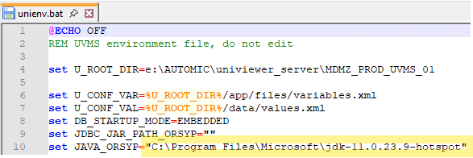
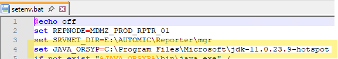
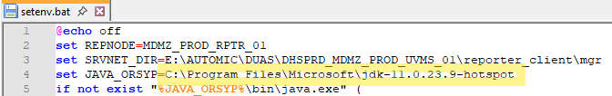
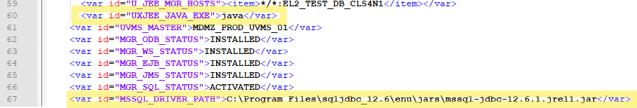

# Update Java for Dollar Universe

## Notes


- We are currently using Open JDK 11 from Microsoft, this is the latest version of Java supported by Dollar Universe Components. It can be found here: [OpenJDK 11](https://learn.microsoft.com/en-us/java/openjdk/download#openjdk-11)
- unienv.bat and/or setenv.bat is a file that exists for most Dollar Universe components that sets environment variables, like node name, node path, node executable path, and path to java.


## UVMS

Updating java on the UVMS server is a little more involved than just updating Java itself, the binary path to java needs to be updated in the unienv.bat file. For the UVMS the java path is absolute, so it needs to be updated when java is updated on the server.

For TEST/PROD UVMS, the path that needs to be updated is on line 10 of file ```E:\AUTOMIC\univiewer_server\MDMZ_PROD_UVMS_01\data\unienv.bat```.



Everytime java is updated on the server, this path will need to updated. We are running Microsoft OpenJDK v11. The  install path has the version number in the name, hence the need to update it.

## Reporter and Reporter Client

Reporter is on the same server as the UVMS and supports extracting job history and storing in SQL Server. The configuration for Reporter is changing slightly with $U v7, which we have yet to install, so this will be for v6.10.

Reporter uses setenv.bat, for TEST/PROD UVMS, that path needs to be updated on line 4 of file ```E:\AUTOMIC\Reporter\mgr\setenv.bat```.



Reporter Client is also on the same server as the UVMS, but it is an 'addon' to the Dollar Universe application node and the path is found under the DUAS node path. On TEST/PROD that is ```E:\AUTOMIC\DUAS\DHSPRD_MDMZ_PROD_UVMS_01\reporter_client\mgr\setenv.bat```, update line 4.



## Dollar Universe Application Server (DUAS)

This should not require any changes for the main service, but if you are updating Java, you might need to update the Java Manager service and the MSSQL Service if it is enabled on that particular server, mostly because we might need to update the JDBC driver to the correct version. Java Manager service is set to use system variables so it can call java without the full path.

For Java 11, the JDBC driver can be found here: [JDBC driver](https://learn.microsoft.com/en-us/sql/connect/jdbc/download-microsoft-jdbc-driver-for-sql-server?view=sql-server-ver17#download). This needs to be extracted to any path on the server and than the path to the correct jdbc .jar file set below.

For some plugins, the MSSQL plugin, it requires the full path for jdbc driver ti bve set. These can be set within the UVC console so it is a little easier. They can also be set in the environment config file, an XML file. This plugin is not enabled on all servers, only a handful of DB nodes and the value will be missing in the .xml file if not set/used.

For example, on Assist's TEST node it can be found on lines 67 in ```M:\AUTOMIC\DUAS\DHSTST_EL2_TEST_DB_CLS4N1\data\values.xml```, these lines can be different per node or missing if Java/MSSQL integration is not enabled. If you need to enable it, do it initial thru the console. Notice line 60, this is the path to java used by the Java Manager plugin, it is using a system variable and calling it without any path included.

