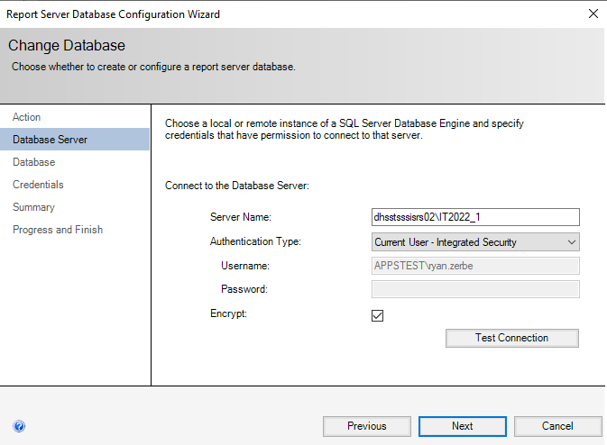
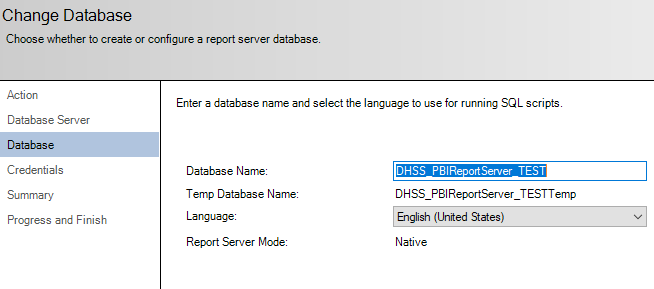
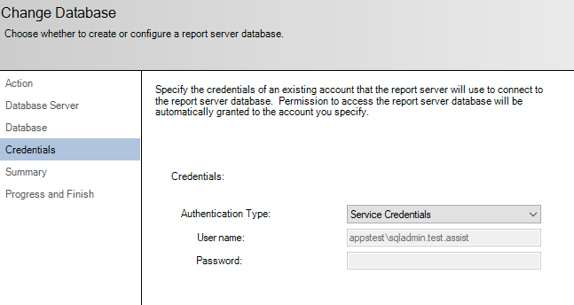
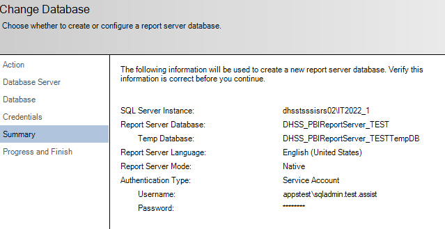
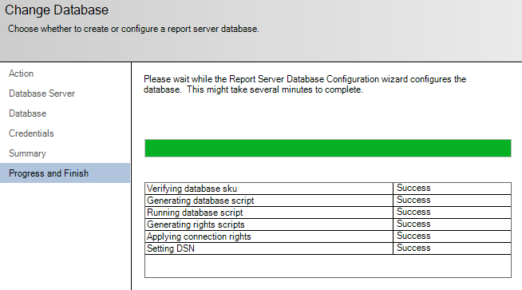
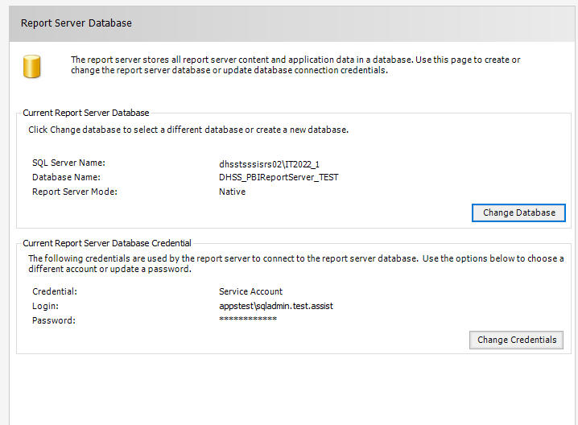
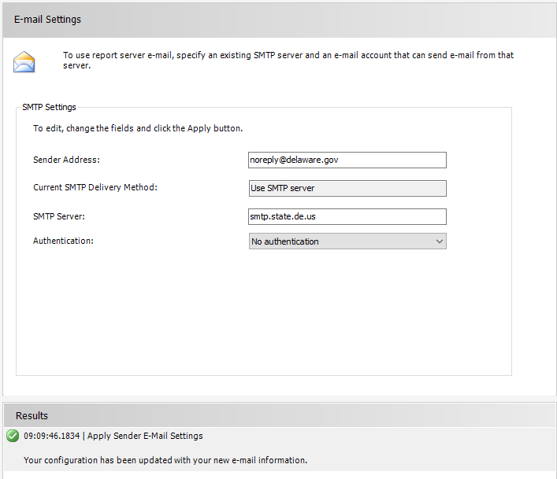
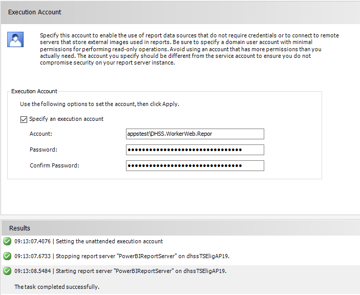

# Install PBIRS

There are no install options, install with default config.

## Config

### Web Service URL

This can cause some issues if there are old reserved URLs. You can view them:

    netsh http show urlacl

Then you can clean up the ones you dont need:

    netsh http delete urlacl URL=http://+:80

### Database

This will be blank at first, we are using the SSIS servers to house the SSRS/PBIRS databases.

For TEST/UAT, first screen is just for initial connectivity testing, following screens are for service connection.

hostssisrs02\IT2022_1

Completed:

### Web Portal URL

This will say not configured/setup when you first visit this screen, there is nothing to do here, it should be pre-filled, just hit 'Apply' unless you know you want to change it. It may take a bit as it goes thru fixing the reservations.

### E-mail Settings

Fill in and click 'Apply'

noreply@delaware.gov
smtp.state.de.us

### Execution Account

This should be the Reports account:

   domain.com.WorkerWeb.Repor

Fill in and click 'Apply'

