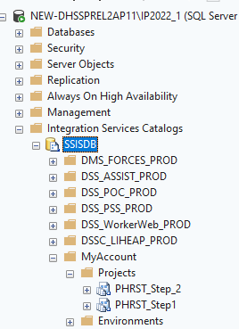
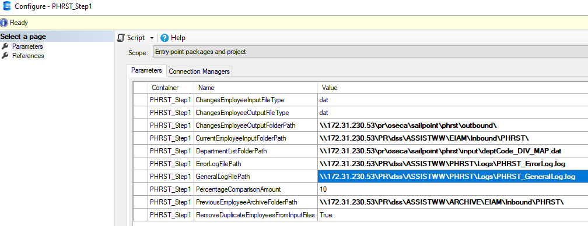
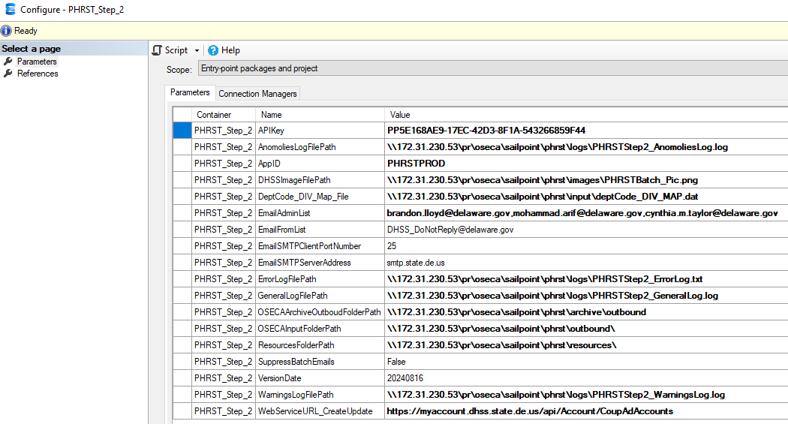

# PHRST MAA Logs

## Instance

### Assist SSIS 2022

```
hostel2ap11\IP2022_1 or xx.xx.xx.xx,15150
```

These SSIS packages are what do the work, we need the logs from them. It's not logs in SSISDB itself, but log files generated from the packages to the file system. There is a general log and an error. I usually just send the general log. If the log files is 25MB+, you should zip it first. This runs in EL2, you can browse to that network share from any other server in EL2.



## Step 1

logs: \\\xx.xx.xx.xx\PR\dss\ASSISTWW\PHRST\Logs\




## Step 2

logs: \\\xx.xx.xx.xx\pr\oseca\sailpoint\phrst\logs\

