# SQL Server 2019+ Install and Configuration

- [SQL Server 2019+ Install and Configuration](#sql-server-2019-install-and-configuration)
  - [Standards and Policies](#standards-and-policies)
  - [Pre-Install Checks](#pre-install-checks)
    - [Drive Letters](#drive-letters)
    - [Drive Size and Blocksize](#drive-size-and-blocksize)
    - [Firewall Rules](#firewall-rules)
    - [Enable Network DTC](#enable-network-dtc)
    - [Default Folders](#default-folders)
  - [Install](#install)
  - [Post-Install Setup](#post-install-setup)
  - [Post-Install Configuration](#post-install-configuration)
    - [Audits](#audits)
    - [Kerberos](#kerberos)
    - [Solarwinds and Sentry](#solarwinds-and-sentry)
    - [Tempdb](#tempdb)
    - [Hardening](#hardening)
  - [END](#end)

## Standards and Policies

- Backup Policies, up for debate.
  - DEV: All user backups chould go to NUL unless stated otherwise by business
  - TEST: Consider user backups to go to NUL
- Backup Locations
  - DEV: \\\\xx.xx.xx.xx\\Backup
  - TEST
    - EL2:  \\\\xx.xx.xx.xx\\dbbackup
    - IDMZ3: \\\\xx.xx.xx.xx\\
  - PROD
    - EL2: \\\\xx.xx.xx.xx\\dbbackup
    - IDMZ3: \\\\xx.xx.xx.xx\\

## Pre-Install Checks

### Drive Letters

 | Label      | Size        | Path                  | Comment                                     |
 | ---------- | ----------- | --------------------- | ------------------------------------------- |
 | OS         | 100gb       | C:\                   |                                             |
 | Data       | varies      | D:\Data               |                                             |
 | Logs       | varies      | L:\Logs               |                                             |
 | Management | up to 500gb | M:\                   |                                             |
 | SystemDB   | up to 100gb | S:\<MSSQL##.Instance> | SQL Installer creates this folder           |
 | TempDB     | up to 100gb | T:\TempDB             | Can be less for smaller install.            |
 | TempDBLog  | up to 10gb  | U:\TempDBLog          | not entirely necessary for smaller installs |

### Drive Size and Blocksize

Run below script at an elevated prompt.

```powershell
Get-CimInstance -ClassName Win32_Volume | 
? Capacity -ge 0 |
Select-Object DriveLetter, Label, BlockSize, 
@{n="Size(GB)";e={[math]::Round($_.Capacity/1GB,2)}}, 
@{n="Free(GB)";e={[math]::Round($_.FreeSpace/1GB,2)}} | 
Sort DriveLetter | Format-Table
```

The drives used with SQL Server(D,L,M,S,T) should have a block size of 65536. If not format each drive with the correct block size via Windows Explorer from an elevated prompt. !!!This will WIPE the drive, so dont do this on an existing setup!!!

```powershell
Format-Volume -DriveLetter D -NewFileSystemLabel Data -AllocationUnitSize 65536
Format-Volume -DriveLetter L -NewFileSystemLabel Logs -AllocationUnitSize 65536
Format-Volume -DriveLetter M -NewFileSystemLabel Management -AllocationUnitSize 65536
Format-Volume -DriveLetter S -NewFileSystemLabel SystemDB -AllocationUnitSize 65536
Format-Volume -DriveLetter T -NewFileSystemLabel TempDB -AllocationUnitSize 65536
Format-Volume -DriveLetter U -NewFileSystemLabel TempDBLog -AllocationUnitSize 65536 # if exists
```

### Firewall Rules

Run below script at an elevated prompt to open ports for SQL Server and DTC:

```powershell
New-NetFirewallRule -DisplayName "SQL Server" -Direction Inbound -LocalPort 5022, 15150 -Protocol TCP -Action Allow
New-NetFirewallRule -DisplayName "SQL Server Browser" -Direction Inbound -LocalPort 1434 -Protocol UDP -Action Allow
Enable-NetFirewallRule -DisplayGroup "Distributed Transaction Coordinator"
Set-NetFirewallProfile -Profile Domain, Public, Private -Enabled True
```

### Enable Network DTC

You may need to enable XA or LU transcation types depending on the application. Last 2 options below.

```powershell
Set-DtcNetworkSetting -DtcName Local -AuthenticationLevel NoAuth -InboundTransactionsEnabled $true -OutboundTransactionsEnabled $true -RemoteClientAccessEnabled $true -RemoteAdministrationAccessEnabled $false -XATransactionsEnabled $false -LUTransactionsEnabled $false
```

### Default Folders ###

```powershell
New-Item D:\Data -Force -ItemType Directory
New-Item L:\Logs -Force -ItemType Directory

New-Item M:\Management\Audit -Force -ItemType Directory
New-Item M:\Management\Backup -Force -ItemType Directory
New-Item M:\Management\Reports -Force -ItemType Directory
New-Item M:\Management\Restore -Force -ItemType Directory
New-Item M:\Management\Scripts -Force -ItemType Directory
New-Item M:\Setup -Force -ItemType Directory

New-Item T:\TempDB -Force -ItemType Directory
New-Item U:\TempDBLog -Force -ItemType Directory # may not need this, check if U: exists
```

## Install

1. Obtain and mount .iso.
   > SW_DVD9_NTRL_SQL_Svr_Ent_Core_2019Dec2019_64Bit_English_OEM_VL_X22-22120.ISO

1. Launch setup.exe and wait for installer to start.

1. Click **Installation** tab and then **New SQL Server stand-alone...**.

   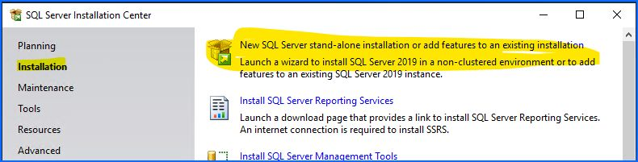

1. Click **Next** a few times, check agree to **license terms**, do not check **Microsoft update**, and then let it do its checks. **Windows Firewall** warning is ok, we will address later, we will be changing listening port anyway.

1. **Feature Selection**, choose only **Database Engine Services** unless you know you need more. Then click **Next**.

   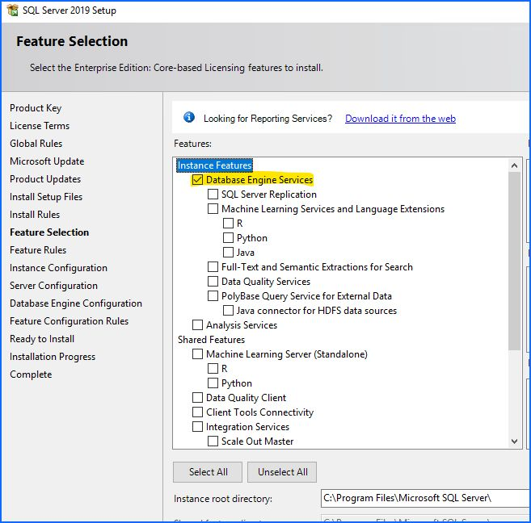

1. **Instance Configuration**, change to **Named instance** and choose a proper name for the environment. You will probably need to consult the [instance spreadsheet](https://wss.domain.com/dms/irm/basetech/Shared%20Documents/Database/db_Database_Server_Environments.xlsx) to determine the next available sequence. **Instance ID** should update once you change the **Named instance**. Click **Next**.

   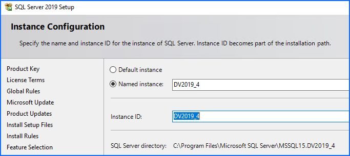

1. **Server Configuration**, change **SQL Server Agent** and **SQL Server Database Engine** to use the appropriate **dom\*\sqladmin** account, password can be found in **Keepass**. Make **SQL Server Agent** as Automatic **Startup Type** and check **Grant Perform Volume Maintenance Task privege to SQL Server Database Engine Service**. This enables faster initialization of files. Click **Next**. **Collation** is fine at default. Click **Next**.

   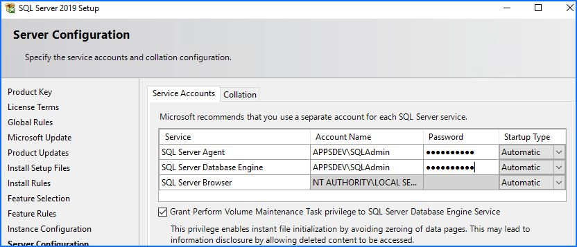

1. **Database Engine Configuration** \- **Server Configuration** pane, set **Authentication Mode** to **Mixed Mode** and set **sa** password, can be found in **Keepass**. Below, click **Add...** and add the appropriate DBA group for the environment. Don't forget to add the DBA group to the local admin group for DBA access.

   Run ``lusrmgr.msc`` for GUI or run ``Add-LocalGroupMember -Group Administrators -Member <DbaGroupName>`` from an elevated prompt.

   ```text
  domain.comSG_dv_SQLServerAdmins
  domain.comSG_TS_IRM_SQLAdmins
  domain.comSG_IRM_SQLAdmins
   ```

   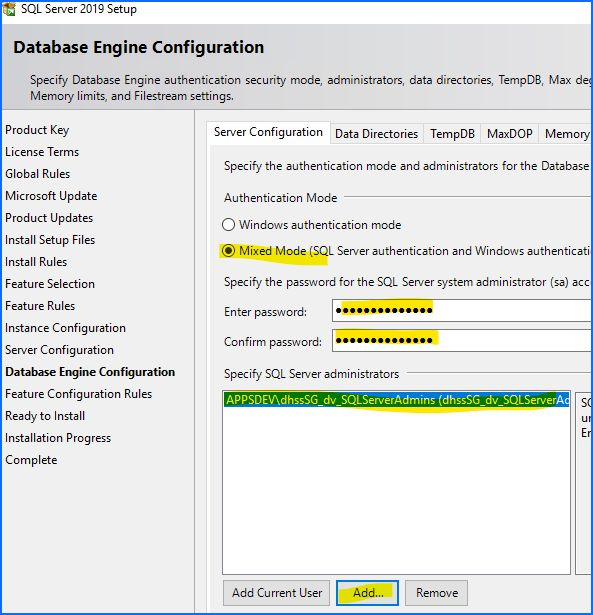

1. **Database Engine Configuration** - **Data Directories** pane, set all paths as below for local paths and set Backup directory for the appropriate environment's UNC path. The UNC backup path will give you a warning to verify the account being used for SQL has write permissions.

   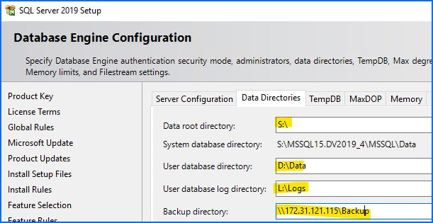

1. **Database Engine Configuration** - **TempDB** pane, set **Number of files** to match server's core count, up to 8, this should be the default. You can leave the **Initial size** and **Autogrowth** to defaults, we will adjust this after install. Change TempDB **Data directories** to as below. If there is a TempDB log drive setup, change that to U:\TempDBLog, else leave as is, it will follow the data directory.

   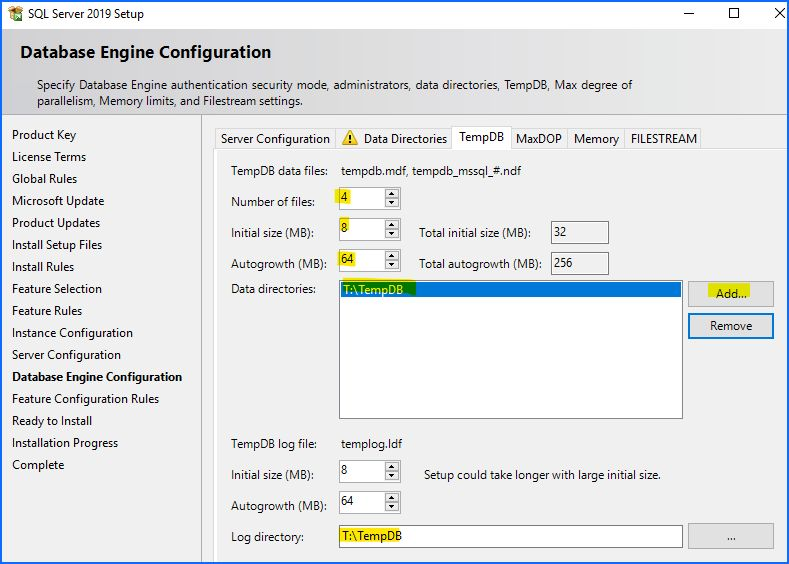

1. **Database Engine Configuration** - **MaxDOP** and **FILESTREAM** can remain at default unless you know you need to change them. They can be changed after install. On **Memory** tab, change to **Recommended** setting and Click the checkbox below. You might need to lower the Memory allocated to SQL if this server will run SSIS too. SSIS processes run outside of SQL's memory allocation. For older versions of SQL Server, the tempdb configuration will not be here and you will need to configure it manually. See below under optional for more info on doing so.

   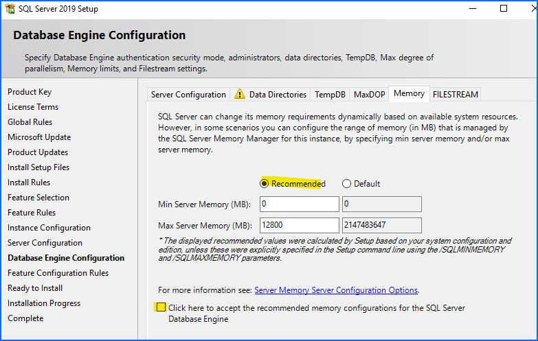

1. **Click Next**, verify install configuration, click **Install**, and wait for completion.

   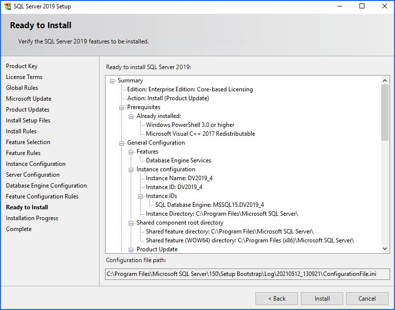

1. Completed.

   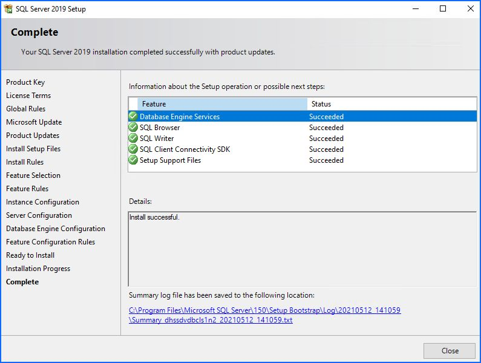

## Post-Install Setup

1. Run any SQL Server SP-CU updates that need to be run.

1. **Change SQL Port**. From **Start Menu** open **Sql Server Configuration Manager**, browse to **SQL Server Network Configuration**, **Protocols for *instance***, then right-click on **TCP/IP** and then **Properties**. On **TCP/IP**, second tab, **IP Addresses**, then at bottom, blank out **TCP Dynamic Ports** and set **TCP Port** to 15150. Click **Ok**.

   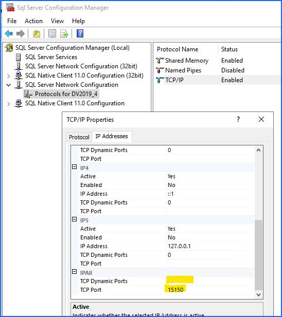

1. **Enable AlwaysOn** (if needed), while still in **Sql Server Configuration Manager**, in SQL Server Services, right-click->properties on **SQL Server(*instancename*)**, go to **Always On Availability Groups** and Enable.

   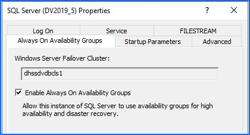

1. Enable trace flags for Autoseed compression(if using AlwaysOn) and disable log messages for successful backups. Add startup parameters **-T3226**, **-T7745** and **-T9567**.

   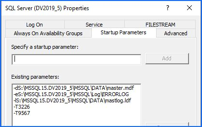

1. After all of above changes, restart **SQL Server** service, can be done from **Sql Server Configuration Manager**.

## Post-Install Configuration

**Important: When working with Availability Groups and logins, please make sure to add logins to all replicas involved in the Availability Group or there could be access issues during a failover. This applies to system and user logins.**

Note: Doing third party scripts first as some of the other setup revolves around them being installed already.

1. Create **'basetech'** login as **sysadmin** role; SQL Server authentication, no password policy or expiration. Password is in **Keepass**, make sure to use the new password. Validate **'basetech'** works, then disable and rename **'sa'**. Starting June 2025 we are disabling and renaming **'sa'** and using a strong password, audit finding for DECSS, using policy globally for better security.

   ```sql
   USE [master]
   GO
   CREATE LOGIN [basetech] WITH PASSWORD=N'<password>', DEFAULT_DATABASE=[master], CHECK_EXPIRATION=OFF, CHECK_POLICY=OFF
   ALTER SERVER ROLE [sysadmin] ADD MEMBER [basetech]
   GO

   ALTER LOGIN [sa] DISABLE
   ALTER LOGIN [sa] WITH NAME = [irmsa]
   ```

1. Increase SQL Error log count to 12.

   ```sql
   EXEC xp_instance_regwrite N'HKEY_LOCAL_MACHINE', N'Software\Microsoft\MSSQLServer\MSSQLServer', N'NumErrorLogs', REG_DWORD, 12
   EXEC xp_instance_regread N'HKEY_LOCAL_MACHINE', N'Software\Microsoft\MSSQLServer\MSSQLServer', N'NumErrorLogs'
   ```

1. Increase SQL Agent Job History limit. Clean up is also handled by an Ola cleanup job, but making it unlimited with log backups every minute can make msdb grow quite large.

   ```sql
   EXEC msdb.dbo.sp_set_sqlagent_properties @jobhistory_max_rows=50000, @jobhistory_max_rows_per_job=1000
   GO
   ```

1. **Third Party Scripts**: install latest release of each.
   1. **MaintenanceSolution.sql**: Editing settings at top of script as necessary. Reports path was created above. Cleanup time is for all backup types, will most likely need to change. There is a step below that calls this out after making other edits. [link](https://ola.hallengren.com/)
   1. **sp_whoisactive**: [link](https://github.com/amachanic/sp_whoisactive/releases)
   1. **Install-Core-Blitz-With-Query-Store.sql** (SQL2016+): [link](https://github.com/BrentOzarULTD/SQL-Server-First-Responder-Kit)

1. **DBMail**: Run this script to setup DBmail:

   ```sql
   USE master
   GO
   sp_CONFIGURE 'show advanced', 1
   GO
   RECONFIGURE
   GO
   sp_CONFIGURE 'Database Mail XPs', 1
   GO
   RECONFIGURE
   GO 
   EXECUTE msdb.dbo.sysmail_configure_sp @parameter_name=N'AccountRetryAttempts', @parameter_value=N'1', @description=N'Number of retry attempts for a mail server'
   EXECUTE msdb.dbo.sysmail_configure_sp @parameter_name=N'AccountRetryDelay', @parameter_value=N'60', @description=N'Delay between each retry attempt to mail server'
   EXECUTE msdb.dbo.sysmail_configure_sp @parameter_name=N'DatabaseMailExeMinimumLifeTime', @parameter_value=N'600', @description=N'Minimum process lifetime in seconds'
   EXECUTE msdb.dbo.sysmail_configure_sp @parameter_name=N'DefaultAttachmentEncoding', @parameter_value=N'MIME', @description=N'Default attachment encoding'
   EXECUTE msdb.dbo.sysmail_configure_sp @parameter_name=N'LoggingLevel', @parameter_value=N'2', @description=N'Database Mail logging level: normal - 1, extended - 2 (default), verbose - 3'
   EXECUTE msdb.dbo.sysmail_configure_sp @parameter_name=N'MaxFileSize', @parameter_value=N'1000000', @description=N'Default maximum file size'
   EXECUTE msdb.dbo.sysmail_configure_sp @parameter_name=N'ProhibitedExtensions', @parameter_value=N'exe,dll,vbs,js', @description=N'Extensions not allowed in outgoing mails'
   EXECUTE msdb.dbo.sysmail_add_account_sp @account_name=N'SQL_Alerts', @description=N'', @email_address=N'dept05SG_SQLAlerts@state.de.us', @display_name=N'SQL_Alerts', @replyto_address=N'dept05SG_SQLAlerts@state.de.us', @mailserver_name=N'smtp.state.de.us', @mailserver_type=N'SMTP', @port=25, @username=N'', @password=N'', @use_default_credentials=0, @enable_ssl=0
   EXECUTE msdb.dbo.sysmail_add_profile_sp @profile_name=N'SQL_Alerts'
   EXECUTE msdb.dbo.sysmail_add_profileaccount_sp @profile_name=N'SQL_Alerts', @account_name=N'SQL_Alerts', @sequence_number=1
   EXECUTE msdb.dbo.sysmail_add_principalprofile_sp @principal_name=N'guest', @profile_name=N'SQL_Alerts', @is_default=1
   GO
   
   -- test config with this line, change 'to'.
   EXECUTE msdb.dbo.sp_send_dbmail @profile_name = 'SQL_Alerts', @recipients = 'ryan.zerbe@delaware.gov',  @body = 'Email test successful.',  @subject = 'Automated Success Message'
   ```

1. **Instance Settings**

   1. **Backup Compression and Checksum**

      ```sql
      EXECUTE sys.sp_configure N'backup compression default', N'1'
      GO
      EXECUTE sys.sp_configure N'backup checksum default', N'1'
      GO
      RECONFIGURE WITH OVERRIDE
      GO
      ```

1. **Operators**

   1. Add Operator

      ```sql
      EXECUTE msdb.dbo.sp_add_operator @name=N'SQL_Alerts', @enabled=1, @email_address=N'dept05sg_SQLAlerts@delaware.gov', @category_name=N'[Uncategorized]'
      ```

   1. Set Failsafe Operator

      ```sql
      EXECUTE master.dbo.sp_MSsetalertinfo @failsafeoperator=N'SQL_Alerts', @notificationmethod=1
      EXECUTE msdb.dbo.sp_set_sqlagent_properties @email_save_in_sent_folder=1, @databasemail_profile=N'SQL_Alerts', @use_databasemail=1
      ```

1. **SQL Agent Job schedules**

   The easiest way to apply these to multiple servers is to create a register server group and query multiple servers at once.

   The next step down sets the notifications on all the Ola jobs.

   These schedules may need to be adjusted for your situation, but this is a good starting point. T-SQL is included to create a schedule for the Ola system maintenance jobs.

   1. **CommandLog Cleanup**
      - Daily at 6am (Daily_6am)

      ```sql
      EXECUTE msdb.dbo.sp_add_jobschedule @job_Name=N'CommandLog Cleanup', @name=N'Daily_6am', 
      @enabled=1, @freq_type=4,  @freq_interval=1,  @freq_subday_type=1,  @freq_subday_interval=0,  
      @freq_relative_interval=0,  @freq_recurrence_factor=1,  @active_start_date=20211101,  
      @active_end_date=99991231,  @active_start_time=60000,  @active_end_time=235959
      ```

   1. **DatabaseBackup - SYSTEM_DATABASES - FULL**

      For DEV:

      - Sundays at 1am (Sunday_1am)

      ```sql
      EXECUTE msdb.dbo.sp_add_jobschedule @job_name=N'DatabaseBackup - SYSTEM_DATABASES - FULL', @name=N'Sunday_1am', 
      @enabled=1, @freq_type=8, @freq_interval=1, @freq_subday_type=1, @freq_subday_interval=0, 
      @freq_relative_interval=0, @freq_recurrence_factor=1, @active_start_date=20211101, 
      @active_end_date=99991231, @active_start_time=10000, @active_end_time=235959
      ```

      For TEST\PROD:

      - Daily at 7pm (Daily_7pm)

      ```sql
      EXECUTE msdb.dbo.sp_add_jobschedule @job_name=N'DatabaseBackup - SYSTEM_DATABASES - FULL', @name=N'Daily_7pm', 
      @enabled=1, @freq_type=4, @freq_interval=1, @freq_subday_type=1, @freq_subday_interval=0, 
      @freq_relative_interval=0, @freq_recurrence_factor=1, @active_start_date=20220520, 
      @active_end_date=99991231, @active_start_time=190000, @active_end_time=235959
      ```

   1. **DatabaseIntegrityCheck - SYSTEM_DATABASES**
      - Sundays at 3am (Sunday_3am)

      ```sql
      EXECUTE msdb.dbo.sp_add_jobschedule @job_name=N'DatabaseIntegrityCheck - SYSTEM_DATABASES', @name=N'Sunday_3am', 
      @enabled=1, @freq_type=8, @freq_interval=1, @freq_subday_type=1, @freq_subday_interval=0, 
      @freq_relative_interval=0, @freq_recurrence_factor=1, @active_start_date=20211101, 
      @active_end_date=99991231, @active_start_time=30000, @active_end_time=235959
      ```

   1. **DatabaseIntegrityCheck - USER_DATABASES**
      - Mondays at 12am (Monday_12am)

      ```sql
      EXEC msdb.dbo.sp_add_jobschedule @job_name=N'DatabaseIntegrityCheck - USER_DATABASES', @name=N'Monday_12am', 
      @enabled=1, @freq_type=8, @freq_interval=2, @freq_subday_type=1, @freq_subday_interval=0, 
      @freq_relative_interval=0, @freq_recurrence_factor=1, @active_start_date=20220131, 
      @active_end_date=99991231, @active_start_time=0, @active_end_time=235959
      ```

   1. **IndexOptimize - USER_DATABASES**
      - Saturdays at 2am (Saturday_2am)

      The schedule of this job depends on different factors, application batch schedule, etc, but this is a good starting point.

      ```sql
      EXEC msdb.dbo.sp_add_jobschedule @job_name=N'IndexOptimize - USER_DATABASES', @name=N'Sundays_2am', 
      @enabled=1, @freq_type=8, @freq_interval=1, @freq_subday_type=1, @freq_subday_interval=0, 
      @freq_relative_interval=0, @freq_recurrence_factor=1, @active_start_date=20220131, 
      @active_end_date=99991231, @active_start_time=20000, @active_end_time=235959
      ```

      Change Index job step to below settings, recommendation from [Brent Ozar](https://www.brentozar.com/archive/2014/12/tweaking-defaults-ola-hallengrens-maintenance-scripts/)

      ```sql
      EXEC msdb.dbo.sp_update_jobstep @job_name='IndexOptimize - USER_DATABASES', @step_id=1, @step_name='IndexOptimize - USER_DATABASES', 
      @command=N'EXECUTE [dbo].[IndexOptimize]
      @Databases = ''USER_DATABASES'',
      @FragmentationLow= NULL,
      @FragmentationMedium = ''INDEX_REORGANIZE,INDEX_REBUILD_ONLINE'',
      @FragmentationHigh = ''INDEX_REBUILD_ONLINE'',
      @FragmentationLevel1 = 50,
      @FragmentationLevel2 = 80,
      @UpdateStatistics = ''ALL'',
      @OnlyModifiedStatistics = ''Y'',
      @LogToTable = ''Y'''
      ```

   1. **Output File Cleanup**
      - Sundays at 10pm (Sunday_10pm)

      ```sql
      EXECUTE msdb.dbo.sp_add_jobschedule @job_name=N'Output File Cleanup', @name=N'Sunday_10pm', 
      @enabled=1, @freq_type=8, @freq_interval=1, @freq_subday_type=1, @freq_subday_interval=0, 
      @freq_relative_interval=0, @freq_recurrence_factor=1, @active_start_date=20211101, 
      @active_end_date=99991231, @active_start_time=220000, @active_end_time=235959
      ```

   1. **sp_delete_backuphistory**
      - Sundays at 9:30pm (Sunday_930pm)

      ```sql
      EXECUTE msdb.dbo.sp_add_jobschedule @job_name=N'sp_delete_backuphistory',@name=N'Sunday_930pm', 
      @enabled=1, @freq_type=8, @freq_interval=1, @freq_subday_type=1, @freq_subday_interval=0, 
      @freq_relative_interval=0, @freq_recurrence_factor=1, @active_start_date=20211101, 
      @active_end_date=99991231, @active_start_time=213000, @active_end_time=235959
      ```

   1. **sp_purge_jobhistory**
      - Sundays at 9pm (Sunday_9pm)

      ```sql
      EXECUTE msdb.dbo.sp_add_jobschedule @job_name=N'sp_purge_jobhistory', @name=N'Sunday_9pm', 
      @enabled=1, @freq_type=8, @freq_interval=1, @freq_subday_type=1, @freq_subday_interval=0, 
      @freq_relative_interval=0, @freq_recurrence_factor=1, @active_start_date=20211101, 
      @active_end_date=99991231, @active_start_time=210000, @active_end_time=235959
      ```

   1. **DatabaseBackup - USER_DATABASES - \***
      This is dependant on the environment, the application, the batch schedule (if one exists), and the SLA. For DEV environment, a 1x weekly full backup will suffice. TEST and PROD depend a lot on the factors above and should be discussed with the application team. Diff and Log backups will most likely be needed outside of DEV or with an Availability Group.
      - FULL - Sunday at 1:05am (Sunday_105am)

      ```sql
      EXEC msdb.dbo.sp_add_jobschedule @job_name=N'DatabaseBackup - USER_DATABASES - FULL', @name=N'Sunday_105am', 
      @enabled=1, @freq_type=8, @freq_interval=1, @freq_subday_type=1, @freq_subday_interval=0, 
      @freq_relative_interval=0, @freq_recurrence_factor=1, @active_start_date=20220131, 
      @active_end_date=99991231, @active_start_time=10500, @active_end_time=235959
      ```

      - FULL - Sunday and Wednesday at 2:30am (Sun_Wed_230am)

      ```sql
      EXEC msdb.dbo.sp_add_jobschedule @job_name='DatabaseBackup - USER_DATABASES - FULL', @name=N'Sun_Wed_230am', 
      @enabled=1, @freq_type=8, @freq_interval=72, @freq_subday_type=1, @freq_subday_interval=0, 
      @freq_relative_interval=0, @freq_recurrence_factor=1, @active_start_date=20220831, 
      @active_end_date=99991231, @active_start_time=23000, @active_end_time=235959
      ```

      - DIFF - Daily at 7:00pm (Daily_7pm)

      ```sql
      EXEC msdb.dbo.sp_add_jobschedule @job_name=N'DatabaseBackup - USER_DATABASES - DIFF', @name=N'Daily_7pm', 
      @enabled=1, @freq_type=4, @freq_interval=1, @freq_subday_type=1, @freq_subday_interval=0, 
      @freq_relative_interval=0, @freq_recurrence_factor=1, @active_start_date=20220831, 
      @active_end_date=99991231, @active_start_time=190000, @active_end_time=235959
      ```

   1. **DatabaseBackup - USER_DATABASES - LOG**
      This is dependant on the environment, the application, the batch schedule (if one exists), and the SLA. For DEV environment, we really dont need LOG backups unless there is a cluster involved. TEST and PROD depend a lot on the factors above and should be discussed with the application team. For AWW, we have them running every 1 minute, DECSS is every 15 minutes and Dept cluster is every 30 minutes. There are scripts below for every hour and every minute.

      Disable Reports, we run log backups so frequently, there is no reason to save them to disk.

      ```sql
      EXEC msdb.dbo.sp_update_jobstep @job_name=N'DatabaseBackup - USER_DATABASES - LOG', @step_id=1, @output_file_name=N''
      ```

      **Every 1 hour (DEV--if needed)**

      ```sql
      EXEC msdb.dbo.sp_add_jobschedule @job_name=N'DatabaseBackup - USER_DATABASES - LOG', @name=N'Every_1hr', 
      @enabled=1, @freq_type=4, @freq_interval=1, @freq_subday_type=8, @freq_subday_interval=1, 
      @freq_relative_interval=0, @freq_recurrence_factor=1, @active_start_date=20220225, 
      @active_end_date=99991231, @active_start_time=0, @active_end_time=235959
      ```

      **Every 1 minute (TEST or PROD)**

      ```sql
      EXEC msdb.dbo.sp_add_jobschedule @job_name='DatabaseBackup - USER_DATABASES - LOG', @name=N'Every_1min', 
      @enabled=1, @freq_type=4, @freq_interval=1, @freq_subday_type=4, @freq_subday_interval=1, 
      @freq_relative_interval=0, @freq_recurrence_factor=0, @active_start_date=20220520,
      @active_end_date=99991231, @active_start_time=0, @active_end_time=235959
      ```

      **Every 15 minutes (another option)**

      ```sql
      EXEC msdb.dbo.sp_add_jobschedule @job_name='DatabaseBackup - USER_DATABASES - LOG', @name=N'Every_15mins', 
      @enabled=1, @freq_type=4, @freq_interval=1, @freq_subday_type=4, @freq_subday_interval=15, 
      @freq_relative_interval=0, @freq_recurrence_factor=1, @active_start_date=20220606, 
      @active_end_date=99991231, @active_start_time=0, @active_end_time=235959

      ```

   Once all scheduling is completed, you can view Job Activity Monitor and see the schedules.

   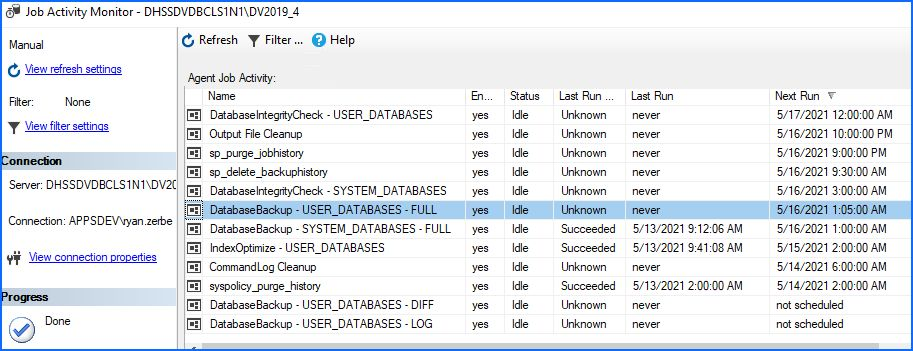

1. **Validate Backup Retention and LogToTable**

   Check FULL, DIFF, and LOG backups are set to the correct *CleanupTime* and that LOG backup has **LogToTable** set to 'N'. **CleanupTime** on all backup jobs will be whatever you set during the OLA install. The correct **CleanupTime** is going to be depend on the application and business needs.

1. **Failure Notifications**

   Add failure notifcations to default Ola jobs.

   ```sql
   EXECUTE msdb.dbo.sp_update_job @job_name=N'CommandLog Cleanup', @notify_level_email=2, @notify_level_page=2, @notify_email_operator_name=N'SQL_Alerts'
   EXECUTE msdb.dbo.sp_update_job @job_name=N'DatabaseBackup - SYSTEM_DATABASES - FULL', @notify_level_email=2, @notify_level_page=2, @notify_email_operator_name=N'SQL_Alerts'
   EXECUTE msdb.dbo.sp_update_job @job_name=N'DatabaseBackup - USER_DATABASES - DIFF', @notify_level_email=2, @notify_level_page=2, @notify_email_operator_name=N'SQL_Alerts'
   EXECUTE msdb.dbo.sp_update_job @job_name=N'DatabaseBackup - USER_DATABASES - FULL', @notify_level_email=2, @notify_level_page=2, @notify_email_operator_name=N'SQL_Alerts'
   EXECUTE msdb.dbo.sp_update_job @job_name=N'DatabaseBackup - USER_DATABASES - LOG', @notify_level_email=2, @notify_level_page=2, @notify_email_operator_name=N'SQL_Alerts'
   EXECUTE msdb.dbo.sp_update_job @job_name=N'DatabaseIntegrityCheck - SYSTEM_DATABASES', @notify_level_email=2, @notify_level_page=2, @notify_email_operator_name=N'SQL_Alerts'
   EXECUTE msdb.dbo.sp_update_job @job_name=N'DatabaseIntegrityCheck - USER_DATABASES', @notify_level_email=2, @notify_level_page=2, @notify_email_operator_name=N'SQL_Alerts'
   EXECUTE msdb.dbo.sp_update_job @job_name=N'IndexOptimize - USER_DATABASES', @notify_level_email=2, @notify_level_page=2, @notify_email_operator_name=N'SQL_Alerts'
   EXECUTE msdb.dbo.sp_update_job @job_name=N'Output File Cleanup', @notify_level_email=2, @notify_level_page=2, @notify_email_operator_name=N'SQL_Alerts'
   EXECUTE msdb.dbo.sp_update_job @job_name=N'sp_delete_backuphistory', @notify_level_email=2, @notify_level_page=2, @notify_email_operator_name=N'SQL_Alerts'
   EXECUTE msdb.dbo.sp_update_job @job_name=N'sp_purge_jobhistory', @notify_level_email=2, @notify_level_page=2, @notify_email_operator_name=N'SQL_Alerts'
   ```

1. **Alerts**

   ```sql
   EXECUTE msdb.dbo.sp_add_alert @name=N'Severity 016', @message_id=0, @severity=16, @enabled=1, @delay_between_responses=60, @include_event_description_in=1
   EXECUTE msdb.dbo.sp_add_notification @alert_name=N'Severity 016', @operator_name=N'SQL_Alerts', @notification_method = 1
   
   EXECUTE msdb.dbo.sp_add_alert @name=N'Severity 017', @message_id=0, @severity=17, @enabled=1, @delay_between_responses=60, @include_event_description_in=1
   EXECUTE msdb.dbo.sp_add_notification @alert_name=N'Severity 017', @operator_name=N'SQL_Alerts', @notification_method = 1

   EXECUTE msdb.dbo.sp_add_alert @name=N'Severity 018', @message_id=0, @severity=18, @enabled=1, @delay_between_responses=60, @include_event_description_in=1
   EXECUTE msdb.dbo.sp_add_notification @alert_name=N'Severity 018', @operator_name=N'SQL_Alerts', @notification_method = 1

   EXECUTE msdb.dbo.sp_add_alert @name=N'Severity 019', @message_id=0, @severity=19, @enabled=1, @delay_between_responses=60, @include_event_description_in=1
   EXECUTE msdb.dbo.sp_add_notification @alert_name=N'Severity 019', @operator_name=N'SQL_Alerts', @notification_method = 1

   EXECUTE msdb.dbo.sp_add_alert @name=N'Severity 020', @message_id=0, @severity=20, @enabled=1, @delay_between_responses=60, @include_event_description_in=1
   EXECUTE msdb.dbo.sp_add_notification @alert_name=N'Severity 020', @operator_name=N'SQL_Alerts', @notification_method = 1

   EXECUTE msdb.dbo.sp_add_alert @name=N'Severity 021', @message_id=0, @severity=21, @enabled=1, @delay_between_responses=60, @include_event_description_in=1
   EXECUTE msdb.dbo.sp_add_notification @alert_name=N'Severity 021', @operator_name=N'SQL_Alerts', @notification_method = 1

   EXECUTE msdb.dbo.sp_add_alert @name=N'Severity 022', @message_id=0, @severity=22, @enabled=1, @delay_between_responses=60, @include_event_description_in=1
   EXECUTE msdb.dbo.sp_add_notification @alert_name=N'Severity 022', @operator_name=N'SQL_Alerts', @notification_method = 1

   EXECUTE msdb.dbo.sp_add_alert @name=N'Severity 023', @message_id=0, @severity=23, @enabled=1, @delay_between_responses=60, @include_event_description_in=1
   EXECUTE msdb.dbo.sp_add_notification @alert_name=N'Severity 023', @operator_name=N'SQL_Alerts', @notification_method = 1

   EXECUTE msdb.dbo.sp_add_alert @name=N'Severity 024', @message_id=0, @severity=24, @enabled=1, @delay_between_responses=60, @include_event_description_in=1
   EXECUTE msdb.dbo.sp_add_notification @alert_name=N'Severity 024', @operator_name=N'SQL_Alerts', @notification_method = 1

   EXECUTE msdb.dbo.sp_add_alert @name=N'Severity 025', @message_id=0, @severity=25, @enabled=1, @delay_between_responses=60, @include_event_description_in=1
   EXECUTE msdb.dbo.sp_add_notification @alert_name=N'Severity 025', @operator_name=N'SQL_Alerts', @notification_method = 1

   EXECUTE msdb.dbo.sp_add_alert @name=N'Error Number 823', @message_id=823, @severity=0, @enabled=1, @delay_between_responses=60, @include_event_description_in=1
   EXECUTE msdb.dbo.sp_add_notification @alert_name=N'Error Number 823', @operator_name=N'SQL_Alerts', @notification_method = 1

   EXECUTE msdb.dbo.sp_add_alert @name=N'Error Number 824', @message_id=824, @severity=0, @enabled=1, @delay_between_responses=60, @include_event_description_in=1
   EXECUTE msdb.dbo.sp_add_notification @alert_name=N'Error Number 824', @operator_name=N'SQL_Alerts', @notification_method = 1

   EXECUTE msdb.dbo.sp_add_alert @name=N'Error Number 825', @message_id=825, @severity=0, @enabled=1, @delay_between_responses=60, @include_event_description_in=1
   EXECUTE msdb.dbo.sp_add_notification @alert_name=N'Error Number 825', @operator_name=N'SQL_Alerts', @notification_method = 1

   -- this one has not notif as we are just trapping it so we dont get spammed with login alerts for untrusted domains
   EXECUTE msdb.dbo.sp_add_alert @name=N'Untrusted Domain Alert', @message_id=17806, @severity=0, @enabled=1, @delay_between_responses=0, @include_event_description_in=0
   ```

1. **SSA Job Change Trigger**

   ```sql
   USE [msdb]
   GO
   
   CREATE TRIGGER [dbo].[jobChecker]
   ON [dbo].[sysjobs]
   FOR UPDATE AS
   SET NOCOUNT ON
   
   DECLARE @username VARCHAR(50),
   @hostName VARCHAR(50),
   @jobName VARCHAR(100),
   @newEnabled INT,
   @oldEnabled INT,
   @jobCreated INT,
   @bodyText VARCHAR(200),
   @subjectText VARCHAR(200),
   @servername VARCHAR(50),
   @profileName VARCHAR(50) = 'SQL_Alerts',
   @recipients VARCHAR(500) = 'deptdg_BaseTech_DBA <deptdg_BaseTech_DBA@delaware.gov>'
   
   SELECT @username = SYSTEM_USER
   SELECT @hostName = HOST_NAME()
   SELECT @servername = @@servername
   SELECT @newEnabled = ENABLED FROM Inserted
   SELECT @oldEnabled = ENABLED FROM Deleted
   SELECT @jobName = Name FROM Inserted
   
   IF @newEnabled <> @oldEnabled
   BEGIN
     IF @newEnabled = 1
     BEGIN
       SET @bodyText = 'The user (' + @username + ') enabled the job (' + @jobName +') from ' + @hostName + ' on ' + CONVERT(VARCHAR(20),GETDATE(),100) + '.   '
       SET @subjectText = @servername + ' : [' + @jobName + '] has been ENABLED'
     END
     IF @newEnabled = 0
     BEGIN
       SET @bodyText = 'The user (' + @username + ') disabled the job (' + @jobName +') from ' + @hostName + ' on ' + CONVERT(VARCHAR(20),GETDATE(),100) +    '.'
       SET @subjectText = @servername+' : [' + @jobName + '] has been DISABLED'
     END
     SET @subjectText = 'SQL Job on ' + @subjectText
   
     EXECUTE msdb.dbo.sp_send_dbmail
     @profile_name = @profileName,
     @recipients = @recipients,
     @body = @bodyText,
     @subject = @subjectText
   END
   GO
   
   ALTER TABLE [dbo].[sysjobs] ENABLE TRIGGER [jobChecker]
   GO
   ```

### Audits

   This is recommended for TEST and above.

   Make sure the path exists before running script, 'M:\Management\Audit'.

   ```sql
   USE [master]
   GO
   CREATE SERVER AUDIT [Login_Change_Failed]
   TO FILE ( FILEPATH = N'M:\Management\Audit', MAXSIZE = 150 MB )
   WHERE (NOT ([server_principal_name] like '%SQLTELEMETRY%'))
   ALTER SERVER AUDIT [Login_Change_Failed] WITH (STATE = ON)
   GO
   CREATE SERVER AUDIT SPECIFICATION [Login_Change_Failed_Spec]
   FOR SERVER AUDIT [Login_Change_Failed]
   ADD (FAILED_DATABASE_AUTHENTICATION_GROUP),
   ADD (FAILED_LOGIN_GROUP),
   ADD (SUCCESSFUL_LOGIN_GROUP), /* added for DECSS IRS Audit. You may or may not want it depending on your need and app, it can make your logs big */
   ADD (LOGIN_CHANGE_PASSWORD_GROUP),
   ADD (USER_CHANGE_PASSWORD_GROUP)
   WITH (STATE = ON)
   GO
   
   USE [master]
   GO
   CREATE SERVER AUDIT [Permission_Change]
   TO FILE ( FILEPATH = N'M:\Management\Audit', MAXSIZE = 150 MB )
   ALTER SERVER AUDIT [Permission_Change] WITH (STATE = ON)
   GO
   CREATE SERVER AUDIT SPECIFICATION [Permission_Change_Spec]
   FOR SERVER AUDIT [Permission_Change]
   ADD (DATABASE_PERMISSION_CHANGE_GROUP),
   ADD (DATABASE_OBJECT_PERMISSION_CHANGE_GROUP),
   ADD (SCHEMA_OBJECT_PERMISSION_CHANGE_GROUP),
   ADD (SERVER_OBJECT_PERMISSION_CHANGE_GROUP)
   WITH (STATE = ON)
   GO
   
   USE [master]
   GO
   CREATE SERVER AUDIT [Object_Change]
   TO FILE ( FILEPATH = N'M:\Management\Audit', MAXSIZE = 150 MB )
   WHERE (NOT ([object_name]='telemetry_xevents' OR [server_principal_name]='dom\sentry.admin' OR [server_principal_name] LIKE '%SQLTELEMETRY%' OR [statement] LIKE 'RESTORE VERIFYONLY%' OR [statement] LIKE 'RESTORE LABELONLY%'))
   ALTER SERVER AUDIT [Object_Change] WITH (STATE = ON)
   GO
   CREATE SERVER AUDIT SPECIFICATION [Object_Change_Spec]
   FOR SERVER AUDIT [Object_Change]
   ADD (DATABASE_CHANGE_GROUP),
   ADD (DATABASE_OBJECT_CHANGE_GROUP),
   ADD (SCHEMA_OBJECT_CHANGE_GROUP),
   ADD (SERVER_OBJECT_CHANGE_GROUP)
   WITH (STATE = ON)
   GO
   
   USE [master]
   GO
   CREATE SERVER AUDIT [Principal_Change]
   TO FILE ( FILEPATH = N'M:\Management\Audit', MAXSIZE = 150 MB )
   ALTER SERVER AUDIT [Principal_Change] WITH (STATE = ON)
   GO
   CREATE SERVER AUDIT SPECIFICATION [Principal_Change_Spec]
   FOR SERVER AUDIT [Principal_Change]
   ADD (SERVER_PRINCIPAL_CHANGE_GROUP),
   ADD (DATABASE_OWNERSHIP_CHANGE_GROUP),
   ADD (DATABASE_OBJECT_OWNERSHIP_CHANGE_GROUP),
   ADD (SCHEMA_OBJECT_OWNERSHIP_CHANGE_GROUP),
   ADD (DATABASE_PRINCIPAL_CHANGE_GROUP),
   ADD (DATABASE_ROLE_MEMBER_CHANGE_GROUP)
   WITH (STATE = ON)
   GO
   
   USE [master]
   GO
   CREATE SERVER AUDIT [Audit_Change]
   TO FILE ( FILEPATH = N'M:\Management\Audit', MAXSIZE = 150 MB )
   ALTER SERVER AUDIT [Audit_Change] WITH (STATE = ON)
   GO
   CREATE SERVER AUDIT SPECIFICATION [Audit_Change_Spec]
   FOR SERVER AUDIT [Audit_Change]
   ADD (AUDIT_CHANGE_GROUP)
   WITH (STATE = ON)
   GO
   
   USE [master]
   GO
   CREATE SERVER AUDIT [SSA_Change]
   TO FILE 
   ( FILEPATH = N'M:\Management\Audit', MAXSIZE = 150 MB )
   ALTER SERVER AUDIT [SSA_Change] WITH (STATE = ON)
   GO
   USE [msdb]
   GO
   CREATE DATABASE AUDIT SPECIFICATION [SSA_Change_Spec]
   FOR SERVER AUDIT [SSA_Change]
   ADD (EXECUTE ON OBJECT::[dbo].[sp_add_schedule] BY [public]),
   ADD (EXECUTE ON OBJECT::[dbo].[sp_attach_schedule] BY [public]),
   ADD (EXECUTE ON OBJECT::[dbo].[sp_detach_schedule] BY [public]),
   ADD (EXECUTE ON OBJECT::[dbo].[sp_update_schedule] BY [public]),
   ADD (EXECUTE ON OBJECT::[dbo].[sp_delete_schedule] BY [public]),
   ADD (EXECUTE ON OBJECT::[dbo].[sp_add_jobstep] BY [public]),
   ADD (EXECUTE ON OBJECT::[dbo].[sp_update_jobstep] BY [public]),
   ADD (EXECUTE ON OBJECT::[dbo].[sp_delete_jobstep] BY [public]),
   ADD (EXECUTE ON OBJECT::[dbo].[sp_add_jobschedule] BY [public]),
   ADD (EXECUTE ON OBJECT::[dbo].[sp_update_jobschedule] BY [public]),
   ADD (EXECUTE ON OBJECT::[dbo].[sp_delete_jobschedule] BY [public]),
   ADD (EXECUTE ON OBJECT::[dbo].[sp_add_job] BY [public]),
   ADD (EXECUTE ON OBJECT::[dbo].[sp_update_job] BY [public]),
   ADD (EXECUTE ON OBJECT::[dbo].[sp_delete_job] BY [public])
   WITH (STATE = ON)
   GO
   
   USE [master]
   GO
   CREATE SERVER AUDIT [Instance_Config_Change]
   TO FILE 
   ( FILEPATH = N'M:\Management\Audit', MAXSIZE = 150 MB )
   ALTER SERVER AUDIT [Instance_Config_Change] WITH (STATE = ON)
   GO
   USE [master]
   GO
   CREATE DATABASE AUDIT SPECIFICATION [Instance_Config_Change_Spec]
   FOR SERVER AUDIT [Instance_Config_Change]
   ADD (EXECUTE ON OBJECT::[sys].[sp_configure] BY [public])
   WITH (STATE = ON)
   GO

   ```

### Kerberos

Follow the guide here to enable Kerberos and AD Delegation to get double-hop linked servers working.

   [HOWTO_SQLServer_SPN_Kerberos_Delegation](./HOWTO_SQLServer_SPN_Kerberos_Delegation.md)

### Solarwinds and Sentry

Make a request to the appropriate folks to have Sentry and Solarwinds added for monitoring.

### Tempdb

This is marked as optional as newer SQL Server installers do this during the install. If you are using an older version and need to do it post install, here is the info.

1. Check Tempdb drive size and number of CPU cores on the system. We want to create 1 tempdb file for each core on the system up to 8.

1. If T:(tempdb) is 40 gbs and we have 2 cores, we want 2 tempdb files, plus the log file, so 3 files total. Large configs might have a dedicated TempDBLog(U:) drive, make changes as neccessary to max out the size for that file on that drive and dont account for it on T: with the data files.

1. Divide 40 gb by 3 to get about 13.33, round down to 13 GB.

1. So now we need to alter tempdb to have 2 files, plus log file. One data and one log file should already exist, but we need to modify their sizes. We want to disable auto growth and have the initial sizes of them fill the drive. So we need 2 modifies and 1 add statement.

   ```sql
   USE [master]
   GO
   ALTER DATABASE [tempdb] MODIFY FILE ( NAME = N'tempdev', SIZE = 13GB , FILEGROWTH = 0)
   ALTER DATABASE [tempdb] MODIFY FILE ( NAME = N'templog', SIZE = 13GB , FILEGROWTH = 0)
   ALTER DATABASE [tempdb] ADD FILE ( NAME = N'temp5', FILENAME = N'T:\TempDB\tempdb_mssql_2.ndf', SIZE = 13GB, FILEGROWTH = 0 )
   GO
   ```

1. Run this script to validate changes.

   ```sql
   SELECT name, physical_name AS CurrentLocation, state_desc
   FROM sys.master_files
   WHERE database_id = DB_ID(N'tempdb')
   ```

1. Restart SQL Server and verify changes are correct.

### Hardening

DECSS recently had an IRS audit finding to not have the SQL Server\Agent service account as local or domain admin. This is an attempt to implmenent a Least-Privilege Administrative Model. SQL Server will grant permissions as needs during setup, but there are other folders that the service may need access to--files, backups, etc.

   1. Open an elevated prompt and grant permissions to folders to the service, substitute with the correctly named instance.
  
      ```batch
      icacls "M:\Management\Audit" /grant "NT SERVICE\MSSQL$<instancename>":(OI)(CI)(F) /T
      icacls "M:\Management\Backup" /grant "NT SERVICE\MSSQL$<instancename>":(OI)(CI)(F) /T
      icacls "M:\Management\Restore" /grant "NT SERVICE\MSSQL$<instancename>":(OI)(CI)(F) /T
      icacls "M:\Management\Reports" /grant "NT SERVICE\MSSQL$<instancename>":(OI)(CI)(F) /T
      ```

## END
