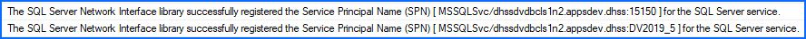
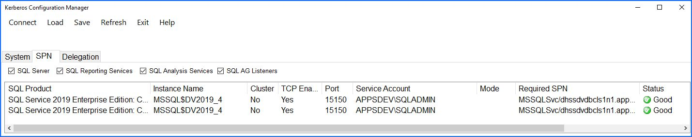
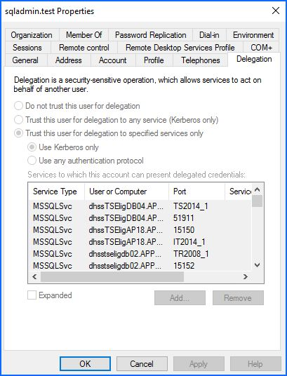

# SQL Server - SPNs and Delegation

- [SQL Server - SPNs and Delegation](#sql-server---spns-and-delegation)
  - [Enable Kerberos](#enable-kerberos)
  - [Enable Delegation](#enable-delegation)

When SQL Server starts, it tries to create SPNs as it deems necessary. If it cannot, you'll get a warning message in the SQL management log. This is not particularly an issue, but without registered SPNs, authenication is limited to NTLM. Kerberos is slightly more secure and authenticates the client and the server.

Kerberos and AD Delegation are technically 2 different topics, but Kerberos and AD Delegation are needed for double hop linked servers. NTLM cannot delegate authentication like Kerberos can. The guide below goes into more detail on it.

There is a more complete [guide here](https://www.sqlshack.com/how-to-link-two-sql-server-instances-with-kerberos/), but our specific details are below.

More info here:

[https://techcommunity.microsoft.com/t5/sql-server/understanding-kerberos-and-ntlm-authentication-in-sql-server/ba-p/383190](https://techcommunity.microsoft.com/t5/sql-server/understanding-kerberos-and-ntlm-authentication-in-sql-server/ba-p/383190)

[https://docs.microsoft.com/en-us/sql/database-engine/configure-windows/register-a-service-principal-name-for-kerberos-connections?view=sql-server-ver15](https://docs.microsoft.com/en-us/sql/database-engine/configure-windows/register-a-service-principal-name-for-kerberos-connections?view=sql-server-ver15)

## Enable Kerberos

1. Grant update SELF permissions for the SQL Service account for creating/updating SPNs, edit as necessary for the domain.

    `dsacls "CN=SQLAdmin,OU=System Accounts,OU=dept,DC=dom,DC=dept" /G SELF:RPWP;"servicePrincipalName"`

1. Restart SQL Service services and let it create it's own SPNs as needed. You will see a line towards the start of the startup process with a message of either success or failure.

   

1. Validate by running [Kerberos Configuration Manager](https://www.microsoft.com/en-us/download/details.aspx?id=39046) or via CLI.

   `setspn -q MSSQL*/*`

   Look for entires under `CN=SQLAdmin,OU=System Accounts,OU=dept,DC=domdev,DC=dept`, or similar for the environment, that match the instances in question.

   

1. SQL Server will not create an SPN for the listener, if you are on an AOAG environment and need to create one, open a command prompt as sqladmin and run the below command. It should be able to SELF update if #1 above was completed. Edit as necessary for the listener and environment.

   `setspn -s "MSSQLSvc/hostname1ls1domain.com:15150" "domain\user"`

1. Check your connection type in SSMS.

   ````sql
   SELECT s.session_id,
          c.connect_time,
          s.login_time,
          s.login_name,
          c.protocol_type,
          c.auth_scheme,
          s.HOST_NAME,
          s.program_name
     FROM sys.dm_exec_sessions s
          JOIN sys.dm_exec_connections c ON s.session_id = c.session_id
   ````

## Enable Delegation

Note: This step is not entirely necessary, it only comes into play when double hopping to a third server via a linked server. 

1. Most of the pre-work of this step is the SPN setup. Once the above is completed, you can go into the AD management console and enable delegate for the sqladmin account for the Kerberos services we setup above.

   **Note**: If the SPN permissions are new, most of the SQL instances will have not yet created the SPNs, as it only happens when SQL starts. You may want to wait some time to complete the delegation step to ensure all the instances have their SPNs created.

   Finding the correct services is a little tricky, click Add, then find the sqladmin account(again) and then you can drill down into the SPNs.

   

1. This can also be done manually in Powershell (easier to have Telecomm just run the command). Change Identity as necessary and add more SPNs as needed.

   ````powershell
   Get-ADObject -Identity 'CN=sqladmin.test,CN=Users,DC=domTest,DC=dept' | Set-ADObject -Add @{'msDS-AllowedToDelegateTo'='MSSQLSvc/hostmcidbc1l1domain.com:15150','MSSQLSvc/hostmcidbc1n1domain.com:15150'}
   ````

   You can then check your results, change to proper user (CN) as needed.

   ````powershell
   Get-ADObject -Identity 'CN=sqladmin decss,OU=System Accounts,OU=dept,DC=dom,DC=dept' -prop * | select -ExpandProperty 'msDS-AllowedToDelegateTo'
   ````
