# SQL Infographics

|                                                    |                                            |
| -------------------------------------------------- | ------------------------------------------ |
| 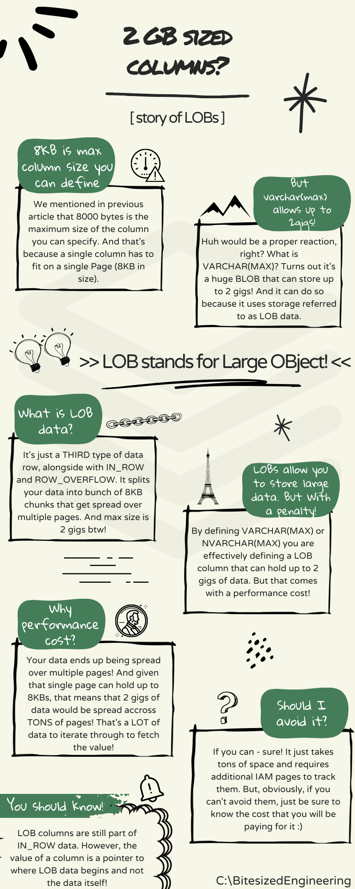               |    |
|        | 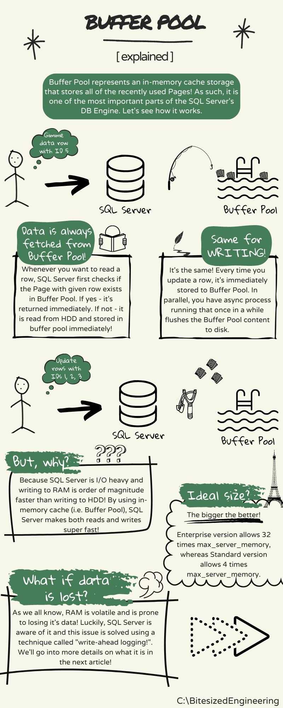       |
| 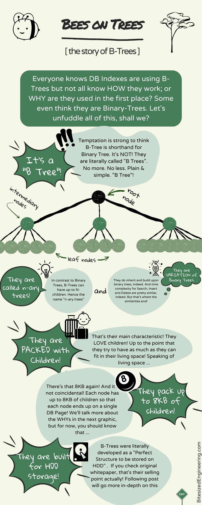                   |   |
| 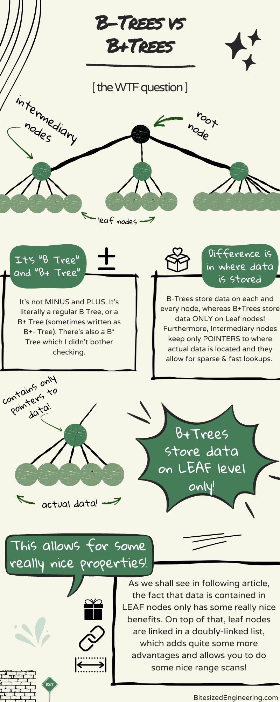                 | 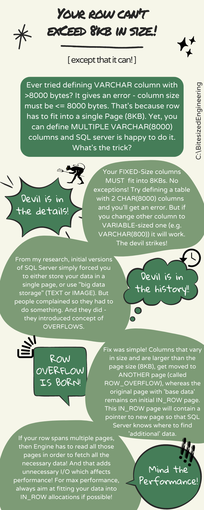   |
|            | 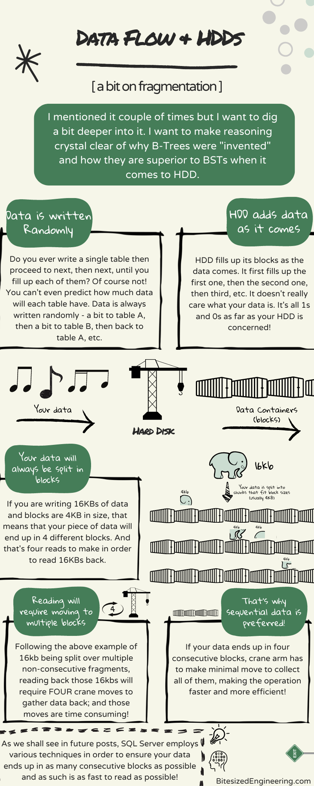    |
|      | 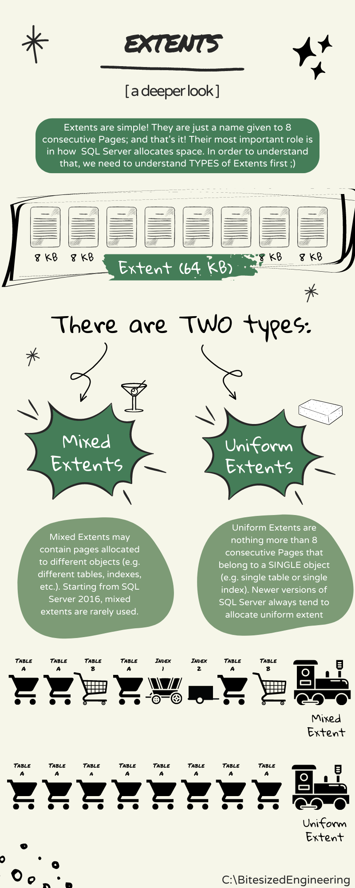           |
| 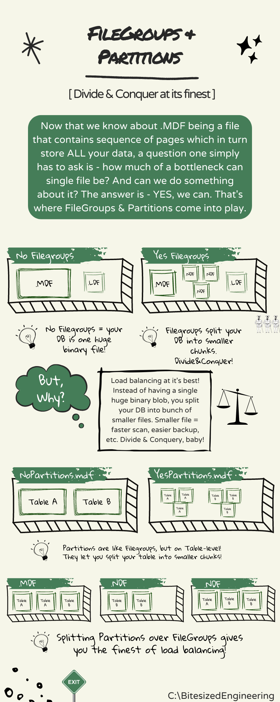     | 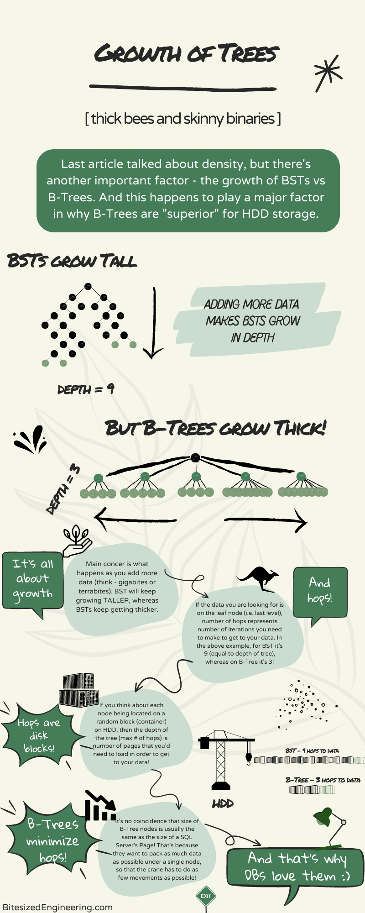   |
| 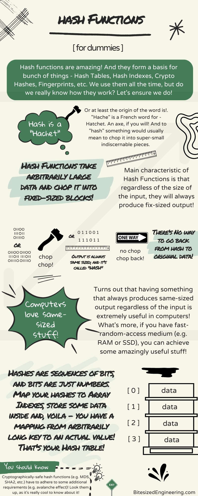            | 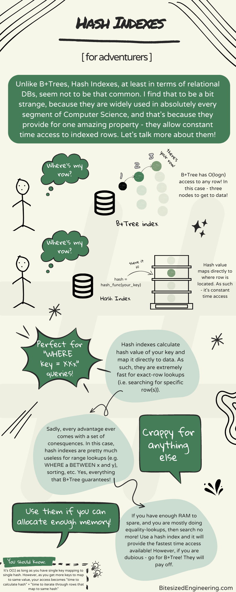      |
| 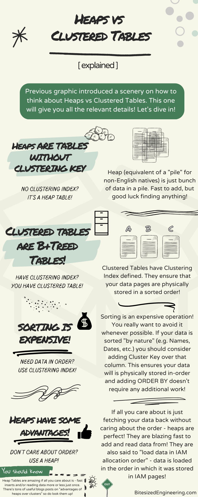 | 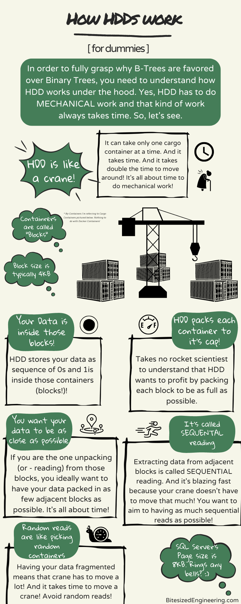      |
|                  | 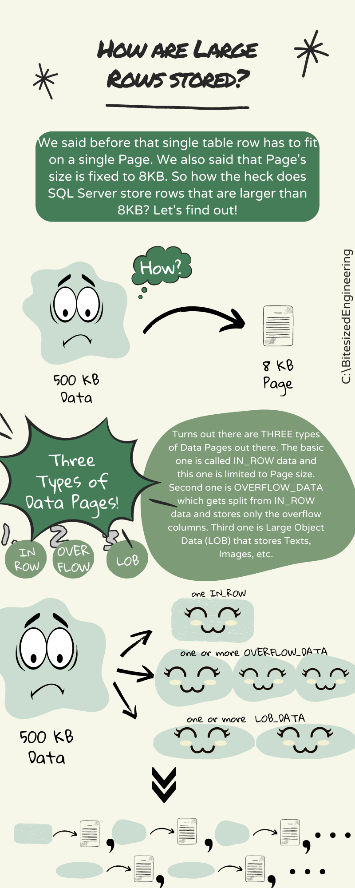        |
|              | 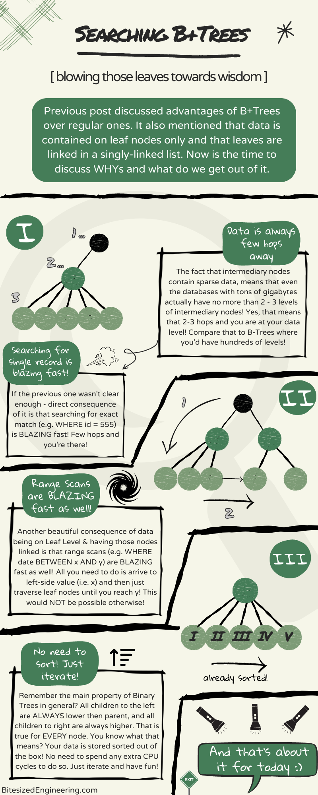 |
| 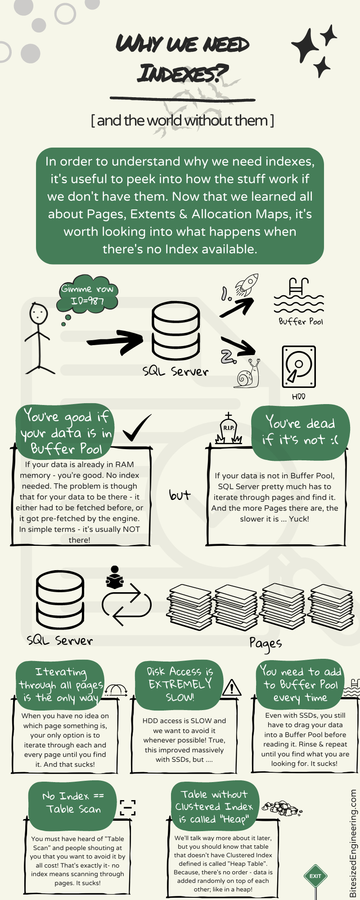               |   |
